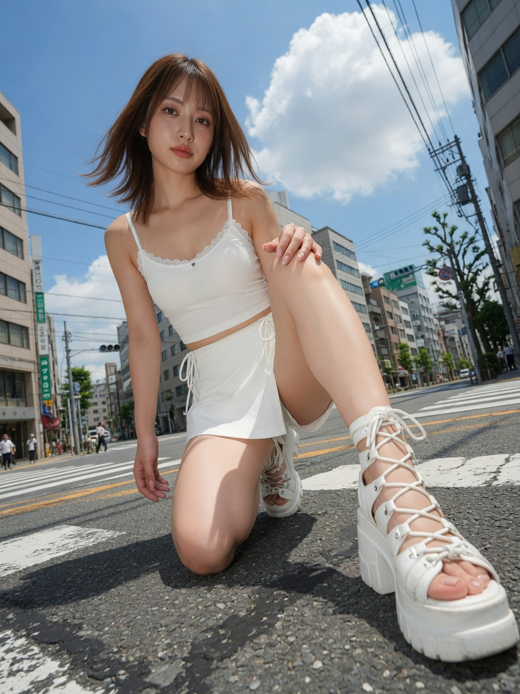

Last updated on 2026-11-13 18-53-26

# Awesome Kling AI 🎬 Kling 4.0 / 3.0 Prompts

[](https://github.com/sindresorhus/awesome) [](./LICENSE) [](https://github.com/DSeaStar/awesome-kling/stargazers)

| [简体中文](./README.md) | [English](./README-en.md) |

> **A Kling prompt library for creators and marketers.** Every prompt is traced to its original post and organized by what you're making: 30-second ads, e-commerce, short drama, UGC talking-head. Swap a few words and generate.

> [!IMPORTANT]
> **Model status (2026-10-15):** Official: Kling 4.0 is now fully available (web creation studio + MCP/CLI); see [@Kling_ai](https://x.com/Kling_ai/status/2110747537187709424). 4.0 prompts live in the [Kling 4.0 section](#0-kling-40).

**Start in three steps:** ① pick a prompt by use case below → ② replace the [bracketed] parts with your product or character → ③ paste into Kling; if it looks off, read that entry's pitfalls and re-run.

Inspired by [awesome-seedance](https://github.com/ZeroLu/awesome-seedance) (sibling list). See [CONTRIBUTING-en.md](./CONTRIBUTING-en.md) and the [weekly crawl log](./docs/x-crawl-log.md).

---

## 📖 Table of Contents

> **Ordering rule:** New prompts always go first within each section. **Kling 4.0** is pinned to the top; Kling 3.0 / Omni follows.

0. [Kling 4.0](#0-kling-40)
1. [Kling 3.0 / Omni](#1-kling-30--omni)
2. [Image-to-Video I2V (from X)](#2-image-to-video-i2v-from-x)
3. [Seedance Prompts (from X)](#3-seedance-prompts-from-x)
4. [Text-to-Image (T2I)](#4-text-to-image-t2i)
5. [Prompt Formula (Start Here)](#5-prompt-formula-start-here)
6. [Cinematic Film Styles](#6-cinematic-film-styles)
7. [Advertising & Commercial Branding](#7-advertising--commercial-branding)
8. [Social Media & Viral Memes](#8-social-media--viral-memes)
9. [UGC Style](#9-ugc-style)
10. [Anime & Animation Styles](#10-anime--animation-styles)
11. [Short-form Drama & Web Series](#11-short-form-drama--web-series)
12. [Visual Effects & Experimental Styles](#12-visual-effects--experimental-styles)
13. [Motion Control & Character Consistency](#13-motion-control--character-consistency)
14. [Resources (API, SDK & How-to-use)](#14-resources)
15. [Contributing](#15-contributing)
16. [Star History](#16-star-history)

---

## 0. Kling 4.0

> **Status (2026-11-09, Asia/Shanghai):** Kling 4.0 is fully available (web creation studio + API). Specs and prompting advice below cite the official user guide, the multiple-keyframes blog, the launch article, and the API changelog; table rows link out where possible. Every prompt in this section is an **adaptable template**, rewritten from the repo’s existing [§7.1 Luxury Perfume Commercial](#71-luxury-perfume-commercial-time-coded) and [§7.2 Sports Drink Ad](#72-sports-drink-ad) plus official public writing guidance. These are **not** community- or maintainer-tested final-film prompts. Anything we have not generated ourselves is marked **template · untested (pending your run)**. No fabricated test results.

Official docs:
- [Kling 4.0 User Guide](https://kling.ai/quickstart/kling-4-model-user-guide)
- [Multiple Keyframes: How to Control a 30-Second AI Video](https://kling.ai/blog/kling-4-multiple-keyframes-guide)
- [Introducing Kling 4.0: Visual Realism, Creative Control, and Next-Level Storytelling](https://kling.ai/blog/kling40-kling-visual-realism-creative-control-introducing-storytelling)
- [API Updates](https://kling.ai/document-api/updates/api.md) (4.0 generally available on 2026-10-28; Flash API on 2026-11-04)

### 0.1. 4.0 vs 3.0 prompting cheat sheet

| Capability | Official spec | Prompting tip | Source |
|------------|---------------|---------------|--------|
| Clip length | Native **3–30s** (user guide: 1-second steps, default 10s) | Write timed beats for the action / camera / sound **between** nodes; do not dump one long paragraph | [User guide](https://kling.ai/quickstart/kling-4-model-user-guide) · [Keyframe blog](https://kling.ai/blog/kling-4-multiple-keyframes-guide) |
| Flash | API (2026-11-04): **3–20s** at **720p**. Official capability map: Flash does **not** support multiple keyframes | Use Flash to iterate; finish on full 4.0. Flash image-to-video currently documents a single first-frame image | [API 11/04](https://kling.ai/document-api/updates/api.md) · [Capability map](https://kling.ai/document-api/guides/capability-map/video.md) |
| Multiple keyframes | Up to about **10** keyframe images per generation | Keyframes control **when** something changes: each one should answer “what must the viewer see at this moment?” You do not need all 10; add a frame only when the visual state truly changes | [Keyframe blog](https://kling.ai/blog/kling-4-multiple-keyframes-guide) |
| Prompt tone | Descriptive, positive language; minimize abstract terms and negative instructions | Replace “premium look” with light, material, props, and framing. Official exceptions: **no subtitles** and **no background music** (the model may add these by default) | [User guide §2.2](https://kling.ai/quickstart/kling-4-model-user-guide) |
| Reference roles | Uploads are numbered in order (`@Image1`, `@Video1`, …) | Give **each reference one clear job** (identity / product / scene / camera). IDs with no role cause the model to infer | [User guide](https://kling.ai/quickstart/kling-4-model-user-guide) · [Omni API](https://kling.ai/document-api/api/video/4-0/video-omni.md) |
| Keyframes vs prompt | Keyframes are visual anchors on the timeline; the prompt explains what happens between them | Describe actions, transitions, camera moves, dialogue, pacing, and sound in the prompt. The prompt timeline must match keyframe order | [Keyframe blog](https://kling.ai/blog/kling-4-multiple-keyframes-guide) |
| Keyframes + Omni Reference | See “two official wordings” below | Plan as: keyframes = when it changes; Omni = what stays consistent. At submit time, follow your current studio entry or API path | [Keyframe blog FAQ](https://kling.ai/blog/kling-4-multiple-keyframes-guide) · [User guide](https://kling.ai/quickstart/kling-4-model-user-guide) |
| Prompt length | Studio / launch article: up to about **8,000 tokens**. API (2026-10-28): about 26,000 English characters or 11,000 non-English | Longer is not automatically better. Use extra length only for what keyframes cannot show | [Keyframe blog](https://kling.ai/blog/kling-4-multiple-keyframes-guide) · [Launch article](https://kling.ai/blog/kling40-kling-visual-realism-creative-control-introducing-storytelling) · [API Updates](https://kling.ai/document-api/updates/api.md) |
| Multi-reference cap | About **15** combined references per task (images + videos + subjects/elements + voices); up to 10 images, up to 5 videos (total duration ≤ 30s), up to 7 elements (including up to 3 video subjects) | Lock consistency with references; write intended changes into keyframes and the prompt so inputs do not conflict | [User guide](https://kling.ai/quickstart/kling-4-model-user-guide) · [Launch article](https://kling.ai/blog/kling40-kling-visual-realism-creative-control-introducing-storytelling) |
| Output | User guide lists 720p / 1080p / **4K**, 21:9 / 16:9 / 1:1 / 9:16 / Auto, 2-channel stereo; 10-bit HDR is listed for 1080p and 4K. The API changelog (2026-10-28) still says “10-bit 4K coming soon” | Check the options in your current studio or API. The launch article also marks extension up to about 2 minutes as coming soon (**unverified** for your account) | [User guide](https://kling.ai/quickstart/kling-4-model-user-guide) · [Launch article](https://kling.ai/blog/kling40-kling-visual-realism-creative-control-introducing-storytelling) · [API 10/28](https://kling.ai/document-api/updates/api.md) |

**Can keyframes and Omni Reference share one task? Two official wordings (follow your current UI):**

1. The [multiple-keyframes blog FAQ](https://kling.ai/blog/kling-4-multiple-keyframes-guide) (2026-09-30) answers *Can I use Multiple Keyframes with Omni Reference?* with **Yes**. The article splits the jobs: keyframes define **when** something should change; Omni Reference helps define **what** should stay consistent.
2. The [user guide](https://kling.ai/quickstart/kling-4-model-user-guide) describes two creation-studio entry points: **Omni Reference** (default, most complete; text-to-video and keyframe-to-video are also available here) and a separate **Keyframes** entry. Quote: *The capabilities of the two entry points cannot be combined within a single generation task.* The standalone Keyframes entry **does not support uploading reference assets**.
3. The official [Omni API](https://kling.ai/document-api/api/video/4-0/video-omni.md) (`/omni-video/kling-4.0`) accepts `first_frame` / `middle_frame` / `last_frame` **and** `refer_image` in the same `contents` list, and tells you to keep `first_frame` first and `last_frame` last when they are combined with reference images. The standalone [image-to-video / keyframe API](https://kling.ai/document-api/api/video/4-0/image-to-video.md) says: if you also need reference videos, elements, or other reference assets, use the Omni endpoint instead.
4. Some third-party studios split the modes. [JXP’s Kling 4.0 prompt guide](https://www.jxp.com/kling/blog/kling-4-0-prompt-guide) (2026-10-29) says its studio separates Text / Reference / Keyframes and relays the user-guide rule that the two cannot be merged in one task.

**Practical takeaway:** At the capability layer (blog + Omni API), plan as if they can work together: references lock identity, keyframes lock timing. If your current UI treats Omni and Keyframes as mutually exclusive entries, pick the one that expresses the main constraint. Follow the interface or API path in front of you.

**Official prompt order (user guide):** reference roles → overall settings → time-stamped event sequence → audio. A seven-part checklist for *what* to decide: Subject + Action + Setting + Camera + Lighting + Pacing + Sound (formula relayed from official launch guidance; the user guide organizes the words into four blocks).

### 0.2. 30s ad storyboard templates

Rewritten from [§7.1](#71-luxury-perfume-commercial-time-coded) / [§7.2](#72-sports-drink-ad), expanded to the official 30-second product-ad keyframe rhythm (0s establish character and setting → 6s introduce the product → 12s move into product use → 20s shift scene or camera → 28s land on the final product hero shot). Status for both: **template · untested (pending your run)**.

#### 0.2.1 Luxury perfume, 30 seconds

*Adapted from [§7.1 Luxury Perfume Commercial (Time-coded)](#71-luxury-perfume-commercial-time-coded) (original ~15s: macro bottle and peonies → hand enters → slow-motion spray → hero lockup) plus the [official keyframe planning table](https://kling.ai/blog/kling-4-multiple-keyframes-guide).*

- **Status:** template · untested (pending your run)
- **Entry points:**
  - **Plain timed-text version** → text-to-video (Omni Reference default entry with no uploads, or a Text-to-Video control)
  - **Keyframe-plan version** → Keyframes mode; upload 5 images you prepare, anchored at 0 / 6 / 12 / 20 / 28s. You do not need all 10 slots
  - If your UI or the Omni API lets you attach a reference as well: use `@Image1` only to lock the bottle, and let keyframes handle composition
- **Duration:** 30s (native maximum; matches the official 0 / 6 / 12 / 20 / 28 product-ad example)
- **Aspect ratio:** 16:9 for a landscape commercial; change 【aspect ratio】 to 9:16 for feeds
- **Replaceable slots:** 【aspect ratio】【brand name】【bottle look】【flowers】【hand details】【mist color】【music yes/no】

**A. Plain timed-text version (paste-ready)**

```text
【Aspect ratio: 16:9】. One continuous 30-second luxury perfume commercial, photoreal fashion-advertising look, geometrically stable product.

Setting: a vanity table in warm afternoon light. A pale cream linen cloth, several 【pink peonies】 in a clear glass vase, petal edges outlined in gold by a left rim light. Behind them, a softly blurred beige wall and a fall of silk curtain. Fine dust motes drift in the air.

Product: a single 【rectangular amber-glass perfume bottle with a matte black cube cap and a small white front label that reads "【BRAND NAME】"】. Keep the bottle’s proportions, label lettering, and cap material identical throughout. The bottle does not warp; the label stays readable.

Character: one 【right feminine hand, warm natural skin, short rounded bare-pink nails, no ring】 entering from the right. Only this hand appears; no full face.

Pacing: the first 12 seconds are slow, quiet, and approaching; 12–20 seconds complete the spray; after 20 seconds the frame grows darker and the mist more visible; the last 2 seconds hold a clean hero lockup.

0–6s: Establish the setting. Medium-close shot, almost locked camera with an extremely slow push-in. First we see the sunlit vanity, the 【pink peonies】, and slowly falling petals. The perfume bottle sits farther back on the left and is not yet the visual center. Shallow depth of field, flowers slightly soft in the foreground.

6–12s: Introduce the product. The camera glides along the tabletop and focus shifts from the flowers to the bottle. Before 12 seconds, the full bottle is visible. Rim light shows the thickness of the amber glass and the fine matte grain on the cap. One petal brushes the bottle’s shoulder.

12–20s: Product use. The same hand enters from the right, fingertips touch the glass, lift the bottle, and the index finger presses the atomizer. Slow-motion 【pale gold】 mist; the background drops darker and rim light makes each droplet visible. The hand moves naturally. The bottle’s shape and label stay stable while it moves.

20–28s: Shift the camera. Cut to a closer rim-lit angle: mist drifts and a thread of it settles on a peony petal. The camera makes a very slow quarter-orbit around the now-stationary bottle, keeping the full bottle in frame and the label toward camera. Do not change the product appearance, tabletop material, and lighting style at the same time.

28–30s: End on a clean product hero shot. The complete bottle sits slightly left of center, with a deeper, emptier space on the right for later type. Volumetric light from back-left, cream minimal background, bottle perfectly still. Hold.

Audio: very quiet room tone, a silk rustle, a short atomizer hiss, a faint petal landing. No subtitles. No background music.
```

**B. Keyframe plan (you supply the 5 images)**

Per the [official advice](https://kling.ai/blog/kling-4-multiple-keyframes-guide), each frame should answer “what must the viewer see at this point?” Do not add extra frames just to fill the quota.

| Time | ID | What this image must show | Job of this frame |
|------|----|---------------------------|-------------------|
| 0s | KF0 | Warm afternoon vanity and 【pink peonies】; the 【bottle】 farther back on the left, not centered | Establish the setting; product is not yet the hero |
| 6s | KF6 | Full bottle in sharp focus, 【BRAND NAME】 label readable; flowers recede into foreground or background blur | Introduce the product |
| 12s | KF12 | The same 【hand】 touching or lifting the bottle, atomizer about to be pressed or just pressed | Move into product use |
| 20s | KF20 | Darker background, 【pale gold】 mist, closer rim-lit angle; bottle still complete | Shift camera and atmosphere |
| 28s | KF28 | Clean hero lockup: complete bottle, centered or left with copy space, cream minimal background | Land on the product hero shot |

**C. Keyframe-mode companion prompt (paste-ready; describe motion between frames, not the pictures you already uploaded)**

```text
Use the uploaded keyframes as visual anchors on the timeline: KF0 at 0s, KF6 at 6s, KF12 at 12s, KF20 at 20s, KF28 at 28s. The prompt only describes how the video moves between these nodes. Do not rewrite the composition, bottle, or lighting already fixed in each keyframe.

A 30-second 【aspect ratio: 16:9】 photoreal luxury perfume commercial. Bottle geometry, the label "【BRAND NAME】", and cap material stay consistent with the keyframes.

0–6s: Start from KF0’s established setting. The camera pushes in very slowly across the vanity, petals drift down, and focus eases from the flowers toward the farther bottle, arriving at KF6 at 6 seconds.
6–12s: The camera keeps gliding closer. The 【feminine right hand】 enters from the right, fingertips touch the glass, and she lifts the bottle, arriving at KF12’s held, ready-to-spray pose at 12 seconds.
12–20s: The index finger presses the atomizer and 【pale gold】 mist sprays in slow motion. The background darkens; rim light picks out the droplets. After the action, the camera transitions into KF20’s closer rim-lit angle.
20–28s: Mist keeps drifting. The camera makes a very slow orbit around the still bottle and lands on KF28’s hero frame at 28 seconds.
28–30s: Hold KF28. The bottle does not move.

Audio: room tone, silk rustle, atomizer hiss. No subtitles. No background music.
```

**Pitfalls:**
1. Do not change character, setting, product, style, and camera all in one keyframe — the [official guide lists this as a common mistake](https://kling.ai/blog/kling-4-multiple-keyframes-guide). Advance one main change at a time.
2. The prompt timeline must match keyframe order. If the prompt sprays at the opening while KF12 is the first use beat, the direction conflicts.
3. Avoid abstract phrases such as “premium look” or “luxurious mood”; write rim light, amber-glass thickness, and matte grain instead. Apart from “no subtitles” and “no background music,” minimize negative instructions ([user guide](https://kling.ai/quickstart/kling-4-model-user-guide)).
4. Fine label type is easily redrawn. Put 【BRAND NAME】 in the prompt and use a large, sharp label in KF6 and KF28.

#### 0.2.2 Sports drink, 30 seconds

*Adapted from [§7.2 Sports Drink Ad](#72-sports-drink-ad) (original ~12s: ice-bead macro → athlete drinks → fast cuts of sprint / high-five / spin → lockup with slogan space) plus the same official 0 / 6 / 12 / 20 / 28 rhythm.*

- **Status:** template · untested (pending your run)
- **Entry points:**
  - **Plain timed-text version** → text-to-video; if you have a pack shot, use Omni Reference and let `@Image1` lock the bottle only
  - **Keyframe-plan version** → Keyframes mode, 5 images you prepare, anchored at 0 / 6 / 12 / 20 / 28s
- **Duration:** 30s. The original §7.2 is a brisk 12-second piece; once you stretch it to 30s, keep the “fast cuts” inside 20–28s so the opening is not already over-edited
- **Aspect ratio:** 16:9 (broadcast feel) or 9:16 (feeds)
- **Replaceable slots:** 【aspect ratio】【drink name】【bottle look】【athlete details】【location】【slogan-space placement】

**A. Plain timed-text version (paste-ready)**

```text
【Aspect ratio: 16:9】. A 30-second sports-drink commercial, photoreal commercial grade, steady at first and faster later.

Product: one 【frosted translucent plastic sports bottle filled with fluorescent orange-green liquid, a white sport cap, and a front label that reads "【DRINK NAME】"】. Keep the bottle structure, liquid color, and label identical throughout. The bottle does not warp.

Character: a 【woman athlete around twenty-five, short hair, deep skin tone, black fitted tank and shorts, a thin silver bracelet on her left wrist】. It is the same person in every beat; hair, wardrobe, and bracelet do not change.

Setting: a 【city outdoor running track】 at dawn, dark-gray rubber lane, glass towers and leftover streetlight glow in the distance. The air is cold; a thin mist hangs near the ground.

Pacing: 0–12s build thirst and introduce the product; 12–20s open and drink; 20–28s accelerate into a sprint and a high-five; the last 2 seconds are a clean product lockup with room for a slogan.

0–6s: Establish setting and character. A medium-wide shot, camera creeping forward at a low angle along the track. The athlete does one last warm-up near the start line, her breath visible, and has not reached for the drink yet. The track, the city dawn, and her black kit are clearly readable.

6–12s: Introduce the product. Cut to a macro of the bottle: the 【fluorescent orange-green】 liquid sits near center, ice beads sliding slowly down the wall, side rim light sparking along each bead, track thrown out of focus. Before 12 seconds the "【DRINK NAME】" label is fully readable. The athlete’s hand enters from above and grips the bottle but does not open it yet.

12–20s: Product use. She twists off the white sport cap and drinks in a clean tilt. Some liquid leaves the mouth of the bottle in slow motion and hangs in the morning light; the city track stays as soft bokeh. Her face, short hair, and left-wrist bracelet match the earlier beats. The label remains identifiable in her hand.

20–28s: Shift pace and camera. Three clear actions rather than a messy montage: (1) the same athlete sprints down the track still holding the same bottle; (2) she high-fives another runner; (3) the bottle makes a slow three-quarter turn against a clean background so the label faces camera again. Do not change the bottle design or wardrobe colors during these actions.

28–30s: Product lockup. The complete bottle stands in the left third or the center, with a clean darker field on the right or above for 【one slogan line】. Liquid color, cap, and label match the rest of the film. Hold.

Audio: dawn outdoor air, distant traffic, sliding ice beads, a cap click, a swallow and splash, sprint footsteps, one crisp high-five. No subtitles. No background music.
```

**B. Keyframe plan (you supply the 5 images)**

| Time | ID | What this image must show | Job of this frame |
|------|----|---------------------------|-------------------|
| 0s | KF0 | 【City track】 at dawn; the 【short-haired athlete】 warming up at the start line; the bottle is not yet the visual center | Establish character and setting |
| 6s | KF6 | Bottle macro: ice beads, 【fluorescent orange-green】 liquid, readable "【DRINK NAME】" label | Introduce the product |
| 12s | KF12 | The same hand holding the bottle, cap about to come off or just off; athlete identity readable | Move into product use |
| 20s | KF20 | The transition after drinking: she is about to sprint, or has taken the first stride; same bottle | Shift pace / camera |
| 28s | KF28 | Complete bottle hero on a clean background, with slogan space to one side | Land on the product hero shot |

**C. Keyframe-mode companion prompt (paste-ready)**

```text
Use the uploaded keyframes as visual anchors on the timeline: KF0 at 0s, KF6 at 6s, KF12 at 12s, KF20 at 20s, KF28 at 28s. The prompt only describes action, camera, and sound between the nodes. Do not rewrite the person, bottle, or location already fixed in each keyframe.

A 30-second 【aspect ratio: 16:9】 photoreal sports-drink commercial. The bottle, the label "【DRINK NAME】", and the athlete’s short hair, black kit, and left-wrist silver bracelet stay consistent with the keyframes.

0–6s: From KF0, the camera creeps forward at a low angle along the track while she finishes her warm-up, then transitions into KF6’s bottle macro at 6 seconds. Ice beads slide down the bottle.
6–12s: Keep KF6’s product identity. The camera eases back slightly as her hand grips the bottle, arriving at KF12’s opening moment at 12 seconds.
12–20s: She twists the cap off and drinks; splash in slow motion. She then stands and reaches KF20’s ready-to-sprint stance at 20 seconds.
20–28s: The same person sprints, high-fives another runner, and the bottle slowly rotates against a clean background, landing on KF28’s hero lockup at 28 seconds.
28–30s: Hold KF28. The bottle is still, with empty space on one side.

Audio: morning wind, cap click, splash, footsteps, one high-five. No subtitles. No background music.
```

**Pitfalls:**
1. Do not spread the original §7.2 “fast cuts” across the full 30 seconds. Official guidance is to mark keyframes only where the visual state truly changes; keep the faster rhythm inside 20–28s.
2. Athlete identity and bottle design are two separate consistency locks. Repeat “the same person / the same bottle” in the prompt; if you have a pack shot, let `@Image1` lock the SKU only, and do not ask a character reference to also define the bottle.
3. If you use keyframes, the jump from KF0’s wide shot to KF6’s macro is intentional. Write the transition (“from setting into macro”) so the model does not cut to a bottle close-up in 0–6s and steal KF6’s job.

### 0.3. Multi-keyframe product showcase

Turn one e-commerce hero still into a publishable product showcase (front → three-quarter → material close-up → light lifestyle → packshot with copy space). Status: **template · untested (pending your run)**.

- **Entry points:** Keyframes mode (3–5 images you prepare) as the spine; lock SKU consistency with Omni Reference `@Image1` if available. If your UI cannot put references and keyframes in the same task, either make the product crystal-clear *inside* the keyframe images, or run Omni alone first with the prompt below (it also works without keyframe uploads)
- **Duration:** **20 seconds** (a showcase does not need the full 30s). To stretch to 30s, add about 2 seconds to each beat and move the final packshot from 18–20s to 28–30s
- **Aspect ratio:** 1:1 is common for product cards; 9:16 for short-video shelves. After you upload keyframes, the user guide says aspect ratio follows the **first keyframe**
- **Replaceable slots:** 【SKU type and look】【surface / background】【aspect ratio】【duration】【copy-space placement】【lifestyle scene yes/no】

**A. Five-keyframe plan (recommended 20s)**

| Time | ID | What must be visible | Job |
|------|----|----------------------|-----|
| 0s | KF0 | The 【SKU】 standing fully front-on on a 【light-gray marble surface】, label facing camera, matching the e-commerce hero | Hero pack shot |
| 5s | KF1 | The same product at about a three-quarter angle so the side structure reads; label still identifiable | Show volume and side |
| 10s | KF2 | Material / logo close-up: 【surface grain, seam, printed mark】 fills most of the frame, but the product is still recognizable | Material credibility |
| 15s | KF3 | The same product in a light lifestyle setting (for example 【beside a gym bag / on a bathroom counter / in morning table light】), appearance unchanged | In-context use, still the same SKU |
| 19s | KF4 | Back to a clean packshot: complete product, left or center, with empty space on one side for later selling points | Deliverable ending |

Three-frame cutdown if five feels like too many: keep only KF0 (0s front), KF2 (10s material), and KF4 (19s packshot with copy space). The [official guide](https://kling.ai/blog/kling-4-multiple-keyframes-guide) says not to add frames that do not change the visual state.

**B. Paste-ready prompt (action / camera / product consistency; works with or without keyframes once you fill the slots)**

```text
【Aspect ratio: 1:1】. A 【20】-second e-commerce product showcase, photoreal commercial stills come to life, one SKU only, continuous and restrained.

@Image1 defines the SKU itself. Preserve its shape, proportions, color, materials, label, and printing exactly. Do not invent new packaging structure and do not rewrite or remove fine label type.
@Image2 defines only the surface and environmental light: 【light-gray marble, soft window light from 45 degrees left, a clean pale background】. Do not treat any other object that may appear in @Image2 as a second product.
(optional) @Image3 defines only the lifestyle space around 15 seconds and does not change the product.
(optional) @Video1 is referenced only for the slow orbit pacing; do not copy its product or location.

Each reference has one job.

Product: 【a matte white charging case with two matching true-wireless earbuds and a pale-gray debossed mark on the lid】. Only this SKU appears; color and structure do not drift.

0–5s: Start on the front hero. The complete product sits slightly below center. Camera is locked except for an extremely slow push-in. Rim light traces the lid edge; a very weak reflection sits on the surface.
5–10s: The product itself stays still (or rides a very slow, level turntable) while the camera orbits about 90 degrees clockwise to a three-quarter view. The mark stays on a readable side.
10–15s: Push into a material and mark close-up. Focus lands on the 【debossed logo and the lid seam】; the background falls away. Do not change the product’s color, corner radius, or structure.
15–18s: Move into a light lifestyle placement: the same product sits beside 【a dark gym bag and a folded cool-toned towel】, with window light from the same direction as before. The product still matches @Image1 exactly.
18–20s: Return to a clean packshot. The complete product sits left or center, with an even field of light or dark gray on the right for selling-point type. The product is still. Hold.

Light: window light from 45 degrees left as the key, plus a very weak frontal fill on the product’s facing side. Avoid empty black holes.
Audio: very quiet interior room tone. No voiceover. No subtitles. No background music.
```

**C. Example Omni Reference role map**

| Reference | Only job | How to write it |
|-----------|----------|-----------------|
| `@Image1` | SKU identity | `@Image1` defines the product. Preserve shape, color, material, and label. |
| `@Image2` | Scene / surface | `@Image2` defines the surface and light; do not borrow other objects from it as the product. |
| `@Image3` | Lifestyle space (optional) | `@Image3` only provides the space around 15 seconds and does not change the product. |
| `@Video1` | Camera rhythm (optional) | `@Video1` is referenced only for orbit speed, not for product or location. |
| Keyframes KF0–KF4 | Composition at timed nodes | Write “arrive at KFx at Ns”; do not ask a keyframe to also be a second product identity |

**Pitfalls:**
1. Do not ask one reference to lock product identity, scene, *and* style. The user guide wants a purpose and scope for each asset; otherwise the model infers.
2. Keyframe images and `@Image1` must show the same SKU in the same colorway. A white case in the reference and a black case in a keyframe is the kind of conflict the official guide warns about.
3. Fine type, ingredient lists, and small logos are often redrawn (a third-party observation, not a guarantee). Make marks large and sharp in the keyframes, and name “keep the printed mark” in the prompt.
4. Aspect ratio follows the first keyframe after upload — crop all five images to the same ratio so KF0 is not 1:1 while later frames jump to 9:16.
5. The standalone Keyframes entry, per the user guide, cannot take reference uploads. If you need `@Image1` to lock the SKU, prefer the Omni entry or Omni API, and follow your current UI.

### 0.4. 3.0 vs 4.0 same-prompt bake-off protocol

This is not a results write-up. It is a checklist you can run. The repo does not yet have 4.0 comparison films; re-run the same inputs and fill the blank table at the end. An earlier plan to pick 10 entries is narrowed here to **5 older prompts worth running first**, covering product geometry, person + product, native dialogue / lip-sync, two-person lip-sync, and Omni product replacement.

#### Five older entries to re-run

| # | Entry (README anchor) | What the original is testing | How to run it on 4.0 |
|---|-----------------------|------------------------------|----------------------|
| 1 | [§7.1 Luxury Perfume Commercial (Time-coded)](#71-luxury-perfume-commercial-time-coded) | ~15s product geometry + timecode | First run the original text at the original length as 4.0 text-to-video; then run a second job with the §0.2.1 30s expansion (keyframes optional) |
| 2 | [§7.2 Sports Drink Ad](#72-sports-drink-ad) | ~12s bottle consistency + a person drinking | Run the original + a product reference on both 3.0 and 4.0; optionally add a §0.2.2 pass on 4.0 |
| 3 | [§1.1 Late-night rehearsal vlog (native dialogue)](#11-late-night-rehearsal-vlog-native-dialogue) | Native dialogue, lip-sync, handheld vlog | Native audio on for both; on 4.0 you may rewrite the beats with timestamps and add “no subtitles” |
| 4 | [§8.2 Street Argument with On-screen Emphasis](#82-street-argument-with-on-screen-emphasis) | Two-person argument lip-sync | Re-run the original text; record whether each mouth matches its line and whether burned-in subtitles appear |
| 5 | [§7.4 Drone Product Replacement Ad](#74-drone-product-replacement-ad) | Reference-video pacing + reference-image product swap | Use the same `@video1` / `@image1` on 3.0 Omni and 4.0 Omni Reference; on 4.0, give each reference one job as the user guide asks |

#### Input control table (change only the model version if you can)

Fill the “your settings” cells before you submit, so you are not reconstructing the job later.

| Control | Suggested shared value | Entry 1 perfume | Entry 2 drink | Entry 3 rehearsal | Entry 4 argument | Entry 5 drone |
|---------|------------------------|-----------------|---------------|-------------------|------------------|---------------|
| Model A | Your current Kling 3.0 / 3.0 Omni | | | | | |
| Model B | Kling 4.0 (do not pick Flash unless you are explicitly testing Flash) | | | | | |
| Resolution | 1080p on both (Flash tops out at 720p) | | | | | |
| Duration | Use the original length first; log any 30s 4.0 expansion on its own row | 15s / extra 30s | 12s / extra 30s | ~10s (follow the original beats) | Original is untimed; try 8–10s | Follow `@video1`, ≤30s |
| Aspect ratio | Same on both sides | 16:9 | 16:9 or 9:16 | 16:9 | 16:9 | Follow `@video1` |
| Keyframes | Off for original-text bake-off; on for the §0.2 expansions | Off / optional on 30s | Off / optional on 30s | Off | Off | Off |
| References | Match whatever the original prompt already asks for | None, or optional pack shot | Prefer product `@Image1` | None | None | Required: `@video1` for pacing, `@image1` for the drone |
| Audio | Native audio on for dialogue entries; ads should say no background music and no subtitles | | | | | |
| Prompt | Run the **same original text** first; log “4.0 expanded version” separately | | | | | |

#### Fields to record while you watch

- **Consistency (1–5):** Does the product shape, the face and wardrobe, or the location swap mid-clip?
- **Lip-sync (1–5 or N/A):** Do mouths follow the written lines? If you did not listen, write “not audio-checked”
- **Subtitle intrusion:** Yes / no / yes but croppable. The 4.0 user guide notes the model may burn subtitles in by default; write “no subtitles” when you do not want them
- **Usable seconds:** How many seconds of a 30s (or original-length) file could go into an ad or a post without an edit
- **Timing:** Do product appearance, first use, and the hero lockup land near the seconds you wrote (frame-accuracy not required)
- **Other:** Extra fingers, redrawn labels, unrequested cuts, music that appeared on its own

#### Suggested comparison GIF names

Split-screen left/top = 3.0, right/bottom = 4.0. Keep the entry number, date, and mode in the filename so the files can later land in `assets/`:

```text
compare-7-1-perfume-20261109-3p0-vs-4p0.gif
compare-7-1-perfume-20261109-4p0-30s-keyframes.gif
compare-7-2-sportdrink-20261109-3p0-vs-4p0.gif
compare-1-1-rehearsal-vlog-20261109-3p0-vs-4p0.gif
compare-8-2-street-argument-20261109-3p0-vs-4p0.gif
compare-7-4-drone-replace-20261109-3p0-vs-4p0.gif
```

#### Blank results table (fill this in)

| Entry | Model | Duration | Resolution | Keyframes | References | Consistency 1–5 | Lip-sync 1–5 | Subtitle intrusion | Usable seconds | Timing roughly landed? | GIF filename | Notes |
|-------|-------|----------|------------|-----------|------------|-----------------|--------------|--------------------|----------------|------------------------|--------------|-------|
| 7.1 perfume original | 3.0 | | | no | | | N/A | | | | | |
| 7.1 perfume original | 4.0 | | | no | | | N/A | | | | | |
| 7.1 expanded 30s | 4.0 | 30s | | | | | N/A | | | | | |
| 7.2 drink original | 3.0 | | | no | | | | | | | | |
| 7.2 drink original | 4.0 | | | no | | | | | | | | |
| 1.1 rehearsal | 3.0 | | | no | no | | | | | | | |
| 1.1 rehearsal | 4.0 | | | no | no | | | | | | | |
| 8.2 argument | 3.0 | | | no | no | | | | | | | |
| 8.2 argument | 4.0 | | | no | no | | | | | | | |
| 7.4 drone | 3.0 Omni | | | no | video+image | | N/A | | | | | |
| 7.4 drone | 4.0 Omni | | | no | video+image | | N/A | | | | | |

After you fill the table, if one 4.0 result is clearly more stable, consider promoting that *expanded prompt* (not a verbal claim) into the README, and mark the source as Original / repo adaptation per [CONTRIBUTING.md](./CONTRIBUTING.md).

### Sources

- [Kling 4.0 User Guide](https://kling.ai/quickstart/kling-4-model-user-guide) (two studio entries; descriptive positive prompts; minimize negatives; no subtitles / no background music; one job per reference; standalone Keyframes entry cannot take reference assets; the two entries’ capabilities cannot be combined in one generation task; Omni also supports text-to-video and keyframe-to-video)
- [Kling 4.0 Multiple Keyframes: How to Control a 30-Second AI Video](https://kling.ai/blog/kling-4-multiple-keyframes-guide) (up to ~10 keyframes; 3–30s; you do not need all 10; 0 / 6 / 12 / 20 / 28 product-ad example; keyframes = when, Omni = what stays; write the in-between motion in the prompt; ~8,000 tokens and longer ≠ better; FAQ says keyframes can work alongside Omni Reference)
- [Introducing Kling 4.0: Visual Realism, Creative Control, and Next-Level Storytelling](https://kling.ai/blog/kling40-kling-visual-realism-creative-control-introducing-storytelling) (native 30s, up to 10 keyframes, up to ~15 references, 8,000 tokens, stereo, multilingual; 10-bit HDR and extension to about 2 minutes marked coming soon in that article)
- [API Updates](https://kling.ai/document-api/updates/api.md) (2026-10-28: 4.0 API generally available, native up to 30s, up to 10 keyframes; 2026-11-04: 4.0 Flash API, 3–20s at 720p)
- [Omni Video Generation API](https://kling.ai/document-api/api/video/4-0/video-omni.md) (`contents` can include keyframe types and `refer_image` together)
- [Image to Video API](https://kling.ai/document-api/api/video/4-0/image-to-video.md) (keyframe endpoint; switch to Omni if you also need reference videos / elements)
- [Video Capability Map](https://kling.ai/document-api/guides/capability-map/video.md) (Flash does not support Multi-Keyframes)
- Third-party note on entry points only: [JXP Kling 4.0 Prompt Guide](https://www.jxp.com/kling/blog/kling-4-0-prompt-guide) (2026-10-29; says the user guide forbids combining them in one task, and its studio splits Text / Reference / Keyframes)
- This repo: [§7.1](#71-luxury-perfume-commercial-time-coded), [§7.2](#72-sports-drink-ad), [§1.1](#11-late-night-rehearsal-vlog-native-dialogue), [§8.2](#82-street-argument-with-on-screen-emphasis), [§7.4](#74-drone-product-replacement-ad)

## 1. Kling 3.0 / Omni

Prompts for **Kling 3.0 / Pro / VIDEO 3.0 Omni** — multi-shot, native audio, Elements, Motion Control. Full pack: [`prompts/kling-3-omni.md`](./prompts/kling-3-omni.md) · Negatives: [`prompts/negative-prompts.md`](./prompts/negative-prompts.md) · Workflows: [`prompts/workflows.md`](./prompts/workflows.md) · Comparison: [`docs/model-comparison.md`](./docs/model-comparison.md)

> **Newest first.**

### 1.1. Late-night rehearsal vlog (native dialogue)

*Source: [@YourAlphaMom](https://x.com/YourAlphaMom/status/2085350644915765377) (same-prompt bake-off including Kling 3.0 Pro)*

```text
CAMERA: DV 16mm handheld selfie vlog; natural shake; imperfect framing; camera body never visible.
LOOK: Soft tape look, mild grain, realistic skin.
STYLE: Late-night post-practice, tired but happy, intimate.
CHARACTER: Brunette model mid-20s, athletic long-sleeve + joggers, light sweat.
SETTING: Empty dance studio at night, mirrors, wooden floor, water bottle + towel.
STORYBOARD (~2s each): enter out of breath "Finally done… it's way too late." → pan empty studio → drink water "I really needed that." → short dance combo laugh → selfie wave "Okay, I'm going home. Good night."
```

### 1.2. Overhead food B-roll (one shot)

*Source: [@emberbuild](https://x.com/emberbuild/status/2085252050053435406)*

```text
Overhead food B-roll, Kling 3.0, single continuous shot. Batter hits a hot pan; edges crisp; steam in morning light; slow drift; photoreal; no text.
```

### 1.3. Omni block template

```text
[MODE] Kling 3.0 Omni · multi-shot · native audio on
[SUBJECT] …  [ACTION] …  [SETTING] …
[CAMERA] shot · angle · move
[AUDIO] "dialogue" · SFX · ambience
[TIMELINE] [0-3s] Shot 1 — …  [3-7s] Shot 2 — …
[QUALITY] photoreal, stable identity, 4K
```

Official: [Omni User Guide](https://kling.ai/quickstart/klingai-video-3-omni-model-user-guide) · [Prompt Guide](https://kling.ai/blog/kling-ai-prompt-guide)

---

## 2. Image-to-Video I2V (from X)

Kling **image-to-video** prompts crawled from public X posts. Full pack: [`prompts/i2v-from-x.md`](./prompts/i2v-from-x.md) · Log: [`docs/x-crawl-log.md`](./docs/x-crawl-log.md) · **Weekly auto candidates (Mondays)**

> **Newest first** in this section and repo-wide.

### 2.1. Kling 2.1 I2V Collection (highlights)

*Source: [MayorkingAI (@MayorKingAI)](https://x.com/MayorKingAI) — [Thread](https://x.com/MayorKingAI/status/1927126460352893348)*

```text
Tracking shot following a warrior woman riding a massive white wolf running at high speed across a frozen tundra, snow flying up from paws, wind whipping her cloak, cold blue tones, dramatic atmosphere, cinematic realism
```

```text
Aerial tracking shot of two cars drifting around a neon-lit Tokyo highway curve, tire smoke rising, reflections shimmering on wet asphalt. Electric atmosphere, dynamic, intense
```

```text
Slow zoom in on the face of a Korean Man in an elegant tailored suit, looking directly into the camera, centred composition, smoking a cigarette, soft smoke rising, soft ambient light with green and red neon reflections, melancholic expression, cinematic lighting with vintage colour gradation, inspired by Wong Kar-wai's style
```

### 2.2. Kling 2.0 I2V Collection (highlights)

*Source: [MayorkingAI](https://x.com/MayorKingAI/status/1914431899675869327)*

```text
FPV chase cam shot closely tailing a wingsuit flyer diving between narrow cliffs. Arms stretched, wings rippling, sharp mountain edges blur below, crisp sky, sun flaring through peaks, fast shutter, thrilling, adrenaline
```

```text
Slow-motion cinematic tracking shot, a massive whale breaches the ocean surface, glowing from the golden sunset behind. Water cascades off its body, birds scatter mid-air, mountains silhouette in the background. Rippling reflections shimmer. Majestic, awe-inspiring
```

### 2.3. Cloud palace I2V (minimal camera)

```text
Slow push-in, light cloud drift, figure walks slowly, preserve depth and restrained palette, cinematic, 4K
```

### 2.4. Detail-forcing I2V template

*Source: [@creatorslop](https://x.com/creatorslop/status/2085350375784378440)*

```text
Generate a video of [your scene] and include these details: the texture of every major surface, the direction and temperature of the light source, the speed of any movement in the frame, what the background is doing while the subject is in focus, and whether shadows are sharp or soft. Every element should feel chosen, not random.
```

---

## 3. Seedance Prompts (from X)

**Seedance 2.0 / 2.5** prompts crawled from X (shot structure ports well to Kling). Full pack: [`prompts/seedance-from-x.md`](./prompts/seedance-from-x.md)

### 3.1. Roswell 1947 archival film (Seedance 2.5)

*Source: [@soumyattention](https://x.com/soumyattention/status/2085947512582721619)*

```text
[Generation Goal] Recovered-archival 1947 Roswell military documentation film (B&W 16mm grain, scratches, degraded mono audio). Stages: (0-8s) ridge handheld + soldiers order camera off; (8-15s) debris inspection + stretcher; (15-27s) tent gurney alien thrashing; (27-30s) film leader fail. Lock uniforms, alien identity, no modern objects.
```

### 3.2. Premium coffee machine UGC 30s (Seedance 2.5)

*Source: [@SadiaMalik182](https://x.com/SadiaMalik182/status/2085947010293883115)*

```text
Create a 30-second vertical AI UGC product commercial (9:16) for a premium coffee machine.
Style: Ultra-realistic, cinematic UGC, 4K HDR, natural lighting, smooth handheld.
Scene 1 (0-5s) creator enters kitchen with mug: "I finally tried this coffee machine."
Scene 2 (5-10s) beans, water, power button close-ups.
Scene 3 (10-17s) grind, crema, pour, golden morning light.
Scene 4 (17-23s) first sip smile: "This honestly tastes amazing."
Scene 5 (23-27s) product orbit showcase.
Scene 6 (27-30s) hero product + cup, creator smiles to camera.
```

### 3.3. Morning commute 15-shot table (Seedance 2.5)

*Source: [@AIwithSynthia](https://x.com/AIwithSynthia/status/2085943905577734483)*

```text
SHOT 1 ECU phone alarm on sheets → SHOT 2 jolt awake → face wash → toothbrush → fridge POV grab → egg/toast pan → rushed bite → outfit change → shoes lace → corridor rush → metro doors → office badge → keyboard OTS → collapse on bed. Match cuts + SFX per shot.
```

### 3.4. Cat propeller helmet one-take (Seedance 2.0)

*Source: [@saniaspeaks_](https://x.com/saniaspeaks_/status/2085932310923251950)*

```text
Single continuous shot: woman places spinning propeller fan helmet on silver tabby cat, rides scooter; cat lifts and flies beside scooter with dangling legs and flowing fur; handheld smartphone track; photoreal; no cuts.
Negative: cartoon, extra limbs, floating without propeller, text, watermark.
```

### 3.5. Visual Production Graph workflow

*Source: [@HBCoop_](https://x.com/HBCoop_/status/2050246433480020154)*

Compress character + world + layout + shot sequence into one control image; text only handles timing / camera / shot order. See full Seedance pack.

---

## 4. Text-to-Image (T2I)

Kling Image / 可灵生图 prompts. Full multi-language packs live under [`prompts/`](./prompts/).

> In this section (and every category in this repo): **new prompts always go first**.

### 4.1. 青空を踏む白 / White Stepping on Blue Sky

*Extreme low-angle summer crosswalk fashion portrait — pure white outfit, vivid blue sky, wide-angle leg foreground. Aspect **3:4**.*



**Prompt (English, paste-ready):**
```text
Vertical 3:4 photoreal fashion portrait. Extreme low-angle wide close shot from asphalt height at a wide Japanese summer intersection. Woman in her 20s: right knee down (left of frame), left knee raised high toward camera (right of frame), white chunky lace-up platform sandal filling lower-right foreground with strong wide-angle perspective. Calm downward gaze to the low camera, face slightly tilted. Soft features, elongated brown eyes, natural undereye, soft bright brown brows, clean nose, translucent coral-pink lips; sheer pink-beige eyeshadow, subtle blush. Bright brown shoulder-length medium hair, thin sheer bangs, face-framing layers, light wind in the tips. White thin-strap ribbed cropped camisole with lace trim; white high-waist wrap mini skort with gathers and thin drawstring; white thick-soled lace-up sandals. Left hand resting on raised left knee; right hand near asphalt. Mid-rise buildings, street trees, poles, transformers, tangled wires converging skyward, crosswalk, tiny pedestrians; upper frame vivid blue sky and white cumulus. Hard high summer sun, sharp asphalt shadows. Natural skin texture, clear fabric and sandal-lace detail, sharp face and foreground leg, slightly softer background. Fresh blue-and-white summer grade, warm skin tones, no heavy beauty filter, no exaggerated HDR. Not mirrored.
```

**Negative:**
```text
mirrored / left-right flip, left hand detached from raised left knee, deformed toes, deformed sandal straps, extra limbs, warped anatomy
```

**Full pack (日本語 / 中文 / English structured + I2V follow-up):**  
[`prompts/t2i-fashion-portraits.md`](./prompts/t2i-fashion-portraits.md)

---

## 5. Prompt Formula (Start Here)

Kling 3.0 responds best to **cinematic direction**, not keyword soup. Full breakdown: [`prompts/prompt-formula.md`](./prompts/prompt-formula.md).

### Core template

```text
[Subject], [Action], in [Setting].
Camera: [shot type], [movement], [lens / DOF].
Lighting: [key light], [mood].
Style: [film reference], photorealistic, high detail, 4K.
Audio (optional): [dialogue / SFX / ambience].
```

### Multi-shot template (Kling 3.0 strength)

```text
Duration: 10s. Multi-shot sequence. Keep wardrobe and weather consistent.

[0-3s] Shot 1 — Extreme wide establishing:
...

[3-7s] Shot 2 — Medium tracking:
...

[7-10s] Shot 3 — Extreme close-up:
...
```

### Image-to-Video template

```text
Animate the subject in the reference image.
Motion: [specific motion].
Camera: [push-in / pan / orbit / static].
Keep face identity, clothing, and background layout consistent.
Natural motion blur, realistic physics, photorealistic.
```

Commercial playbooks (CN): [`prompts/commercial-use-cases.md`](./prompts/commercial-use-cases.md)

---

## 6. Cinematic Film Styles

Professional cinematic approaches optimized for **Kling 3.0** multi-shot and native audio.

### 6.1. Hollywood Night Rain Racing

*Le Mans energy — dual-driver tension, wet asphalt, green-light launch.*

**Prompt:**
```text
Style: Hollywood professional racing film, cinematic night rain, high stakes.
Duration: 12s. Multi-shot.

[0-4s] Shot 1 — Interior close-up: veteran driver in helmet, rain lashes windshield, dashboard lights on visor, calm nod, mouths "Let's go."
[4-8s] Shot 2 — Rival cockpit: younger driver grips wheel, heavy breathing, adrenaline eyes, whispers "Focus."
[8-12s] Shot 3 — Wide action: starting lights turn green, both cars accelerate on wet asphalt, water sprays into lens, stadium lights streak with motion blur.

Photorealistic, IMAX feel, coherent faces, natural rain physics, 4K.
```

### 6.2. Denis Villeneuve Desert Escape

*Epic scale, desaturated palette, nature vs. machine.*

**Prompt:**
```text
Style: IMAX 70mm, Denis Villeneuve, gritty realism, desaturated, epic scale.
Duration: 12s.

[0-4s] Extreme wide: colossal sandstorm miles high swallows desert; tiny armored convoy races away; Hans Zimmer–style tension.
[4-8s] Cockpit cam: pilot screams "GO! GO!", violent camera shake, sand blasts windshield, sun blocked by dust wall.
[8-12s] Climax: rover launches off dune in slow motion, silhouette against dark storm, lightning inside dust cloud, debris past lens, cut to black.

Photorealistic, catastrophic scale, stable vehicle geometry.
```

### 6.3. Wong Kar-wai Rainy Phone Booth

*Nostalgic Hong Kong art-cinema mood with emotional restraint.*

**Prompt:**
```text
Film style: 90s Hong Kong art cinema, retro film grain, high ISO, amber-green color cast, melancholic.

Core emotional line (for performance): "If memories were canned food, I hope they never expire."
Duration: 10s.

[0-4s] Through rain-streaked glass of a red phone booth; figure in khaki trench coat holds receiver, eyes hollow yet deep; rain distorts face like oil paint.
[4-7s] Extreme close-up on lips and half face; soft whisper into receiver; neon bokeh drifts across skin.
[7-10s] Hangs up, walks into rainy crowd; frame-step / trailing motion blur on the back; city light trails.

Handheld, shallow DOF, emotionally intense, photorealistic film look.
```

### 6.4. Neon Tokyo Rain Sequence

*Blade Runner 2049 lighting language with timed shot escalation.*

**Prompt:**
```text
[0-4s] Wide establishing, static: neon-drenched Tokyo alley at night, heavy rain, reflections on wet asphalt, distant traffic murmur.
[4-8s] Medium, slow dolly forward: figure in black trench coat walks toward camera under red paper umbrella, neon flickering on face.
[8-12s] Close-up tracking: umbrella drops, rain hits face, looks up; rain sound intensifies.
[12-15s] Extreme close-up: raindrops hit neon puddle in slow motion, rings of reflected color, bass fades to silence.

Hyper-realistic, 8K feel, Blade Runner 2049 cinematography, Roger Deakins lighting.
```

### 6.5. Samurai at Sunset (Time-coded)

*Hitchcock vertigo + Kurosawa scale in one 15s beat.*

**Prompt:**
```text
[0-4s] Low-angle wide, static: lone samurai silhouetted against blood-red sunset on windswept ridge, tall grass bending, distant thunder.
[4-8s] Dolly zoom on face as realization hits — background warps (vertigo effect), drums building.
[8-12s] Whip pan into crane rise: army of a thousand torches advancing in the valley, war horns, smoke.
[12-15s] Extreme close-up: hand grips katana hilt, knuckles white, single sweat drop in slow motion, blade draw ring, then silence.

Hyper-realistic, 8K, Akira Kurosawa cinematography.
```

### 6.6. Jazz Pianist with Native Audio

*Performance scene — use Kling native audio / dialogue-friendly phrasing.*

**Prompt:**
```text
Close-up of a jazz pianist's hands flying across a grand piano in a smoky nightclub. Each keystroke ripples warm amber light on lacquered wood. Camera slowly pulls back to reveal upright bass, brushed drums, tenor saxophone. Musicians trade solos, nodding. Cigarette smoke curls through a single spotlight.

Hyper-realistic, intimate jazz club, 4K.
Audio: crisp piano attack, walking bassline, brushed snare, breathy sax melody, room reverb.
```

---

## 7. Advertising & Commercial Branding

Use **Kling AI** for product showcases, brand films, and high-end commercials.

### 7.1. Luxury Perfume Commercial (Time-coded)

**Prompt:**
```text
(0-3s) Macro of luxury perfume bottle among pink peonies, shallow DOF, petals floating in warm afternoon light, soft ambient music.
(3-7s) Camera glides closer; feminine hand enters from right, fingers touch glass; silk rustle.
(7-12s) Slow-motion spray: golden mist against dark background, atomizer hiss, rim light on particles.
(12-15s) Pull-out to hero frame, product centered, volumetric light, cream minimal background, elegant silence.

Hyper-realistic fashion commercial, 8K feel, product-stable geometry.
```

### 7.2. Sports Drink Ad

**Prompt:**
```text
Generate a premium 12-second sports drink commercial for the product in the reference image.
[0-3s] Macro: ice beads sliding down the bottle, side rim light, shallow DOF.
[3-7s] Athlete opens the bottle and drinks, slow-motion splash, urban track bokeh.
[7-10s] Fast cuts: sprint, high-five, bottle hero spin.
[10-12s] Product lockup, clean background, space for slogan.

Brisk pacing, high-end commercial grade, 4K, consistent bottle design.
```

### 7.3. Minimal Brand Lifestyle Film

**Prompt:**
```text
Create a 15-second lifestyle brand film for a minimalist home brand.
Natural indoor daylight, real people, no heavy filters.
Product appears naturally inside everyday scenes — no hard-sell overlays.
Camera: slow push-ins and empty-frame transitions.
Nordic / Japanese minimal aesthetic, calm voiceover space, soft ambient room tone.
```

### 7.4. Drone Product Replacement Ad

**Prompt:**
```text
Match the shot design and editing rhythm of reference video @video1.
Replace every product with the drone in reference image @image1.
Multi-angle showcase of body, propellers, and flight moment.
Color grade: blue and black. New VO and music about drone performance.
Keep product identity stable across all shots.
```

More commercial recipes: [`prompts/commercial-use-cases.md`](./prompts/commercial-use-cases.md)

---

## 8. Social Media & Viral Memes

Attention-first vertical and meme-ready setups for short platforms.

### 8.1. Giant Orange Cat City Meme

**Prompt:**
```text
Style: mockumentary mobile vlog, hyperrealistic CG + real city, 8K fur physics.
Duration: 15s. Vertical 9:16 preferred.

[0-5s] Bustling city street; camera tilts up to reveal a Godzilla-sized orange tabby stuck between skyscrapers, waving paws pitifully; glass deforms under huge paw pads.
[5-10s] Ground POV: traffic flows; giant cat sniffs a bus; driver calmly pets its nose; cat sneezes, blowing hats and leaves.
[10-15s] Cat squeezes free, sits on a bridge making it sag slightly, then lazily grooms itself blocking rush hour; freeze on innocent eyes.

Comedic, photoreal physics, stable giant-scale lighting.
```

### 8.2. Street Argument with On-screen Emphasis

**Prompt:**
```text
Tight medium shot of two eccentric adults on a rainy street corner in heated conversation.
One in oversized trench coat gestures wildly and says: "It's not just a pretzel — it's a sourdough pretzel!"
The other in denim jacket replies: "Who cares. A pretzel's a pretzel!"
Clear lip-sync, natural rain ambience, meme-ready framing, photorealistic.
```

### 8.3. One-Take Hook Vertical

**Prompt:**
```text
Vertical 9:16, 8 seconds, single continuous take.
Creator looks into lens in a messy bedroom, suddenly freezes mid-sentence, eyes widen, slowly turns to off-screen crash sound, then sprints out of frame.
Handheld phone aesthetic, natural noise, no music until the last beat drop.
```

---

## 9. UGC Style

User-generated aesthetics — phone camera energy with controlled surreal twists.

### 9.1. Bathroom Mirror Glitch Vlog

**Prompt:**
```text
Style: mockumentary vlog, hyperreal, fixed-camera real-shot feel, natural bathroom light, light suspense-comedy.
Duration: 15s.

[0-6s] Young woman brushes teeth in front of bathroom mirror, funny faces; reflection is perfectly normal and synced.
[6-11s] She spits, turns to leave; her reflection STAYS, raises an eyebrow mischievously for 2 seconds, then panics and fast-forwards to catch up before vanishing.
[11-15s] She stops at the door, turns back; mirror is empty and normal; confused look to camera; freeze.

Must feel like a "network delay" of the reflection, photoreal, no horror gore.
```

### 9.2. Product Unboxing UGC

**Prompt:**
```text
Phone selfie angle, slightly messy desk, natural window light.
Creator opens a package, genuine surprise reaction, holds product to camera, rotates it, points to 2 features while talking.
Casual English dialogue: "Okay wait — this packaging is actually insane."
UGC realism, mild handheld shake, authentic skin texture, 9:16.
```

### 9.3. Reference Character Speaks Audio

**Prompt:**
```text
Place the person from [Image2] inside the interior of [Image1], keeping the style of [Image2] but the realism of [Image1].
They say the line from [Audio1] with clear lip-sync.
Natural room light, stable identity, subtle head motion, photorealistic.
```

---

## 10. Anime & Animation Styles

Character action, style consistency, and dynamic motion tests.

### 10.1. Martial Arts Tournament Clash

**Prompt:**
```text
Figure 1 battles Figure 2 in a World Martial Arts Tournament arena.
Dynamic anime cinematography, speed lines, impact frames, dust and debris.
Keep both character designs consistent with input images.
Fast cuts between wide clash, close-up grit, and final blow freeze.
```

### 10.2. Otter Mecha Anime Battle

**Prompt:**
```text
An anime sequence where an otter climbs into a large mech: quick cuts of gears and mechanical parts locking.
The otter gives a grim thumbs up, then pilots the mech into battle against a marble octopus.
Dynamic camera, cel-shaded highlights, kinetic action, coherent mecha design.
```

### 10.3. Van Gogh Living Painting

**Prompt:**
```text
Style: Van Gogh post-impressionism oil painting, heavy impasto, swirling brushstrokes, high-saturation blue-yellow contrast.
Duration: 12s animation.

Night sky with huge yellow celestial bodies; nebulae swirl like rivers.
Foreground cypress twists like black flame; valley town windows glow warm yellow.
Entire world slowly flows and breathes along brushstroke directions.

Painterly motion, no photoreal faces, dreamy atmosphere.
```

### 10.4. Motion Graphics from Style Boards

**Prompt:**
```text
Create motion-graphics animation inspired by traditional animation techniques.
Based on the three style examples in the reference images, produce a short animated sequence that captures classic animation energy with modern smoothness.
Bold shapes, clean timing, snappy transitions.
```

---

## 11. Short-form Drama & Web Series

Mini-drama hooks optimized for vertical feeds and emotional beats.

### 11.1. Rainy Night Emotional Mini-Drama

**Prompt:**
```text
Style: popular Chinese mini-drama, fast-cut rhythm, high attractiveness filter, romantic heartbreak, rainy night.
Duration: 15s. Vertical 9:16.

Characters: wealthy male lead (black coat, wet hair, red-rimmed eyes) vs stubborn female lead (white dress, tears).

[0-5s] Female lead turns to leave; male grabs wrist; she turns back, love-hate eyes. Lip-sync: "Let go! We're done!"
[5-10s] Rain streams down faces; he raises a ring/document, fingers trembling. Lip-sync: "Look carefully! I never deceived you!"
[10-15s] Her pupils shake, covers mouth; he pulls her into a tight embrace; camera orbits them. Soft sobs.

Cinematic rain, stable faces, clear lip-sync.
```

### 11.2. Viral CEO Reversal (Vertical)

**Prompt:**
```text
Style: viral CEO "satisfying drama", vertical portrait, high saturation, extreme facial close-ups.
Duration: 15s.

[0-5s] Wedding venue: mother-in-law slams divorce paper onto groom's chest; guests laugh; she pokes his forehead. Lip-sync: "No car, no house? Take this cash and leave!"
[5-10s] Groom smirks, tears the paper; helicopter roar; wind messes her hair; his aura flips dominant. Lip-sync: "This marriage ends only if I say so."
[10-15s] Doors kick open; bodyguards roll red carpet; butler bows with black card. Lip-sync: "Welcome back, Young Master — assets unfrozen!"

Dramatic lighting, clear emotional beats, photoreal.
```

### 11.3. 10s Stage Sketch Comedy

**Prompt:**
```text
10-second variety-show stage sketch: two historical-costume characters on a modern talk-show sofa, New Year red-gold LED walls.
Quick OTS comedy cuts, exaggerated eye-rolls, one modern Bluetooth earbud contrast gag.
Audience laugh lighting pulse, confetti ending, 16:9 stage camera language.
```

---

## 12. Visual Effects & Experimental Styles

Spectacle, physics, and surreal concepts.

### 12.1. Sky Zipper Surrealism

**Prompt:**
```text
Style: surrealism, megalophobia, Hollywood VFX quality, ultra-realistic light.
Duration: 15s.

[0-5s] Perfect blue sky over a city; camera tilts up; a giant metallic zipper appears across the horizon.
[5-10s] Translucent god-scale hand unzips the sky with a roar; blue sky fabric peels; behind it: neon cyberpunk world with flying cars and megastructures.
[10-15s] Pull back: our entire city is a glass snow-globe on a giant's desk; giant leans in to observe.

Photoreal VFX, coherent scale transitions.
```

### 12.2. Orbital Station Collision

**Prompt:**
```text
Catastrophic collision between two massive space stations in low Earth orbit.
Metal shears in slow motion; debris spirals; modules crumple; atmosphere crystallizes into vacuum bursts.
Camera tumbles through wreckage as an EVA astronaut ragdolls past.
Earth looms serene in background.

Hyper-realistic, orbital debris logic, Gravity-film energy, 8K feel.
```

### 12.3. Simple I2V Physics

**Prompt:**
```text
Animate this image with believable physics.
Subtle environmental motion first (wind, cloth, particles), then primary subject action.
Preserve composition and identity. Natural motion blur. Photorealistic.
```

### 12.4. Fluid Morph Between Photos

**Prompt:**
```text
Create fluid morphs between all reference photos.
Seamless identity transitions, continuous camera energy, no hard cuts, dreamlike but structured motion.
```

---

## 13. Motion Control & Character Consistency

Kling-native strengths: **Motion Control**, **Elements / subject binding**, multi-image reference, and identity lock.

### 13.1. Motion Control Retarget

**Prompt:**
```text
Use the motion reference video for body dynamics, timing, and camera energy.
Apply that motion to the character in the image reference.
Preserve identity, face, and clothing from the image; ignore the motion video's identity.
Smooth retargeting, no limb distortion, cinematic lighting, photorealistic.
```

### 13.2. Character Series Consistency

**Prompt:**
```text
Keep the same character identity from the element/reference images across all shots.
Shot A: quiet classroom window monologue.
Shot B: hallway chase, handheld urgency.
Shot C: rooftop confrontation at golden hour.
Same wardrobe, same face, coherent age and hairstyle.
Anime-cinematic or photoreal as specified by references.
```

### 13.3. Fashion Lookbook with Elements

**Prompt:**
```text
Same model identity throughout.
Three outfits from reference images appear in sequence with beat-synced cuts.
Each look: walk cycle medium shot + full-body hero pose + fabric detail close-up.
Clean studio, soft fashion lighting, vertical 9:16.
```

### 13.4. Multi-Reference Scene Build

**Prompt:**
```text
Combine references: character from @image1, location from @image2, product from @image3.
Character walks through the location, naturally interacts with the product, glances to camera, slight smile.
Stable multi-subject consistency, photoreal, gentle steadicam follow.
```

---

## 14. Resources

### Official

- [Kling AI (Global)](https://kling.ai/) — Official product
- [Kling AI (China / Kuaishou)](https://klingai.kuaishou.com/) — CN product entry
- [Kling VIDEO 3.0 Model Guide](https://kling.ai/quickstart/klingai-video-3-model-user-guide) — Native audio, multi-shot, 15s, AI Director
- [Kling VIDEO 3.0 Omni User Guide](https://kling.ai/quickstart/klingai-video-3-omni-model-user-guide) — Multi-modal, multi-shot, native audio
- [Kling VIDEO 3.0 Motion Control User Guide](https://kling.ai/quickstart/motion-control-user-guide) — Reference-video motion transfer, face binding, orientation modes
- [Kling AI Prompt Guide](https://kling.ai/blog/kling-ai-prompt-guide) — Official prompting: camera, lighting, dialogue, multi-shot
- [Kling Open Platform API Overview](https://kling.ai/document-api/quickStart/productIntroduction/overview) — Official API docs
- [Text-to-Video API (3.0 Omni)](https://kling.ai/document-api/api/video/3-0-omni/text-to-video) — T2V reference
- [Image-to-Video API (3.0 Omni)](https://kling.ai/document-api/api/video/3-0-omni/image-to-video) — I2V reference
- [Motion Control API](https://kling.ai/document-api/api/video/motion-control) — Official motion-transfer endpoint

### Prompting guides

- [Kling 3.0 Prompting Guide (fal.ai)](https://blog.fal.ai/kling-3-0-prompting-guide/) — Cinematic intent, structure, API notes
- [How to Use Kling 3.0 Pro in 2026 (fal)](https://fal.ai/learn/tools/how-to-use-kling-3-0-pro) — Multi-shot, camera, Elements, pricing
- [Kling 3.0 Prompt Guide (Atlabs)](https://www.atlabs.ai/blog/kling-3-0-prompting-guide-master-ai-video-generation) — Layered formula + multi-shot patterns
- In-repo: [`prompts/prompt-formula.md`](./prompts/prompt-formula.md)
- In-repo: [`prompts/commercial-use-cases.md`](./prompts/commercial-use-cases.md)
- In-repo: [`prompts/t2i-fashion-portraits.md`](./prompts/t2i-fashion-portraits.md) — T2I fashion portraits
- In-repo: [`prompts/i2v-from-x.md`](./prompts/i2v-from-x.md) — I2V from X
- In-repo: [`prompts/seedance-from-x.md`](./prompts/seedance-from-x.md) — Seedance from X
- In-repo: [`docs/x-crawl-log.md`](./docs/x-crawl-log.md) — crawl log (**weekly Monday**)
- In-repo: [`scripts/weekly_x_crawl.py`](./scripts/weekly_x_crawl.py) — weekly crawl script
- Candidates: [`docs/x-crawl-candidates/`](./docs/x-crawl-candidates/) — auto PR, promote after review

### APIs, SDKs & tooling

| Project | Stars-ish | What it is |
|---------|-----------|------------|
| [KlingAIResearch/ComfyUI-KLingAI-API](https://github.com/KlingAIResearch/ComfyUI-KLingAI-API) | ~176 | Official-adjacent ComfyUI nodes for Kling API |
| [199-mcp/mcp-kling](https://github.com/199-mcp/mcp-kling) | ~40 | MCP server for Kling video generation |
| [vargHQ/sdk](https://github.com/vargHQ/sdk) | ~333 | JSX video SDK — one API for Kling, Flux, etc. |
| [vericontext/vibeframe](https://github.com/vericontext/vibeframe) | ~164 | CLI + MCP for agent video gen (Kling, Veo, Seedance…) with cost caps |
| [gokayfem/ComfyUI-fal-API](https://github.com/gokayfem/ComfyUI-fal-API) | ~203 | ComfyUI nodes for fal.ai models including Kling |
| [ai-sdk Kling provider](https://ai-sdk.dev/providers/ai-sdk-providers/klingai) | — | Vercel AI SDK provider: T2V, I2V, multi-image, motion control |
| [fal.ai Kling models](https://fal.ai/models) | — | Hosted Kling 3.0 / o3 endpoints |
| [yihong0618/klingCreator](https://github.com/yihong0618/klingCreator) | ~220 | Unofficial reverse-engineered client (use at own risk; prefer official API) |
| [chenwr727/KLing-Video-WatermarkRemover-Enhancer](https://github.com/chenwr727/KLing-Video-WatermarkRemover-Enhancer) | ~157 | Watermark cleanup / enhance pipeline for Kling outputs |

### Prompt collections & production skills

- [songguoxs/awesome-video-prompts](https://github.com/songguoxs/awesome-video-prompts) — Veo / Kling / Hailuo prompt pack
- [LichAmnesia/awesome-ad-video-prompts](https://github.com/LichAmnesia/awesome-ad-video-prompts) — Ad-focused prompts (Kling / Seedance / Veo / Runway)
- [geekjourneyx/awesome-ai-video-prompts](https://github.com/geekjourneyx/awesome-ai-video-prompts) — Cross-model AI video prompting resources
- [jnMetaCode/ai-shortfilm-prompts](https://github.com/jnMetaCode/ai-shortfilm-prompts) — Short-film prompt skill (Sora · Kling · Veo · Seedance)
- [Anil-matcha/awesome-ai-video-models](https://github.com/Anil-matcha/awesome-ai-video-models) — Model / API / price comparison
- [backblaze-labs/awesome-video-generation](https://github.com/backblaze-labs/awesome-video-generation) — Broader video-generation API landscape

### Platforms & aggregators

- [fal.ai](https://fal.ai/) — Serverless inference hosting Kling
- [Replicate](https://replicate.com/) — Model hosting ecosystem
- [Pollo AI](https://docs.pollo.ai) — Multi-model video API aggregator
- [EvoLink Kling docs](https://evolink.ai/docs/en/api-manual/video-series/kling/kling-v3-text-to-video) — Third-party Kling API manual

### Sibling lists

- [ZeroLu/awesome-seedance](https://github.com/ZeroLu/awesome-seedance) — Seedance 2.0 prompt collection (format inspiration for this repo)

---

## 15. Contributing

Contributions welcome! Full guide: [CONTRIBUTING-en.md](./CONTRIBUTING-en.md) (**newest-first**, weekly promote checklist, issue/PR templates).

Quick rules:

1. Insert at the **top** of the section (`X.1`)
2. Update `README.md` + `README-en.md`
3. Credit Source; long-form under `prompts/`
4. Promote via `docs/PROMOTE_CHECKLIST.md` + `scripts/dedupe_candidates.py`

---

## 16. Star History

<a href="https://star-history.com/#DSeaStar/awesome-kling&Date">
 <picture>
   <source media="(prefers-color-scheme: dark)" srcset="https://api.star-history.com/svg?repos=DSeaStar/awesome-kling&type=Date&theme=dark" />
   <source media="(prefers-color-scheme: light)" srcset="https://api.star-history.com/svg?repos=DSeaStar/awesome-kling&type=Date" />
   
 </picture>
</a>

---

## License

[MIT](./LICENSE) — free to use, share, and build on. Prompts retain credit to original creators when sourced.
