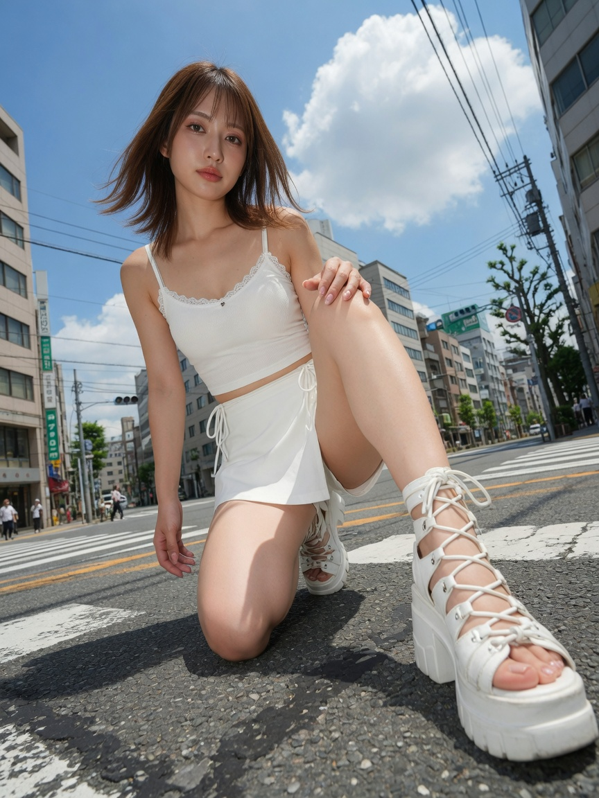

Last updated on 2026-11-13 18-53-26

# Awesome Kling AI 🎬 可灵 4.0 / 3.0 提示词精选

[](https://github.com/sindresorhus/awesome) [](./LICENSE) [](https://github.com/DSeaStar/awesome-kling/stargazers)

| [简体中文](./README.md) | [English](./README-en.md) |

> **给做内容和做营销的人用的可灵提示词库。** 每条标注原帖来源，按"30 秒广告、电商、短剧、UGC 口播"等真实用途分类，拿来改几个词就能用。

> [!IMPORTANT]
> **模型状态（2026-10-15）：** 官方宣布 Kling 4.0 已全面可用（Fully Available），含网页创作台与 MCP/CLI；见 [@Kling_ai](https://x.com/Kling_ai/status/2110747537187709424)。本仓库 4.0 写法见 [4.0 专区](#0-kling-40-专区)。

**三步上手：** ① 在下方目录按用途挑一条 → ② 把方括号里的内容换成你的产品或角色 → ③ 粘贴到可灵生成，不满意就看该条的"避坑"再跑一次。

结构与风格参考 [awesome-seedance](https://github.com/ZeroLu/awesome-seedance)（**sibling 互链**）。欢迎阅读 [CONTRIBUTING.md](./CONTRIBUTING.md) 与 [周更日志](./docs/x-crawl-log.md)。

---

## 📖 目录

> **排序规则：** 各类别内**新增提示词一律插到该节最前面**（最新优先）。**Kling 4.0 专区**置顶；其后为 Kling 3.0 / Omni。

0. [Kling 4.0 专区](#0-kling-40-专区)
1. [Kling 3.0 / Omni 专区](#1-kling-30--omni-专区)
2. [图生视频 I2V（X 精选）](#2-图生视频-i2vx-精选)
3. [Seedance 提示词（X 精选）](#3-seedance-提示词x-精选)
4. [文生图（T2I）](#4-文生图t2i)
5. [提示词公式（从这里开始）](#5-提示词公式从这里开始)
6. [电影风格](#6-电影风格)
7. [广告与商业品牌](#7-广告与商业品牌)
8. [社交媒体与病毒模因](#8-社交媒体与病毒模因)
9. [UGC 风格](#9-ugc-风格)
10. [动漫与动画风格](#10-动漫与动画风格)
11. [短剧与网剧](#11-短剧与网剧)
12. [视觉特效与实验风格](#12-视觉特效与实验风格)
13. [运动控制与角色一致性](#13-运动控制与角色一致性)
14. [资源 (API、SDK 与使用指南)](#14-资源)
15. [贡献指南](#15-贡献指南)
16. [Star 历史](#16-star-历史)

---

## 0. Kling 4.0 专区

> **状态（2026-11-09，Asia/Shanghai）：** Kling 4.0 已全面可用（网页创作台 + API）。规格与写法引自官方用户指南、多关键帧博客、产品介绍文与 API changelog，下文表格尽量带来源短链。本节提示词均为**可改用模板**，改编自仓库已有 [§7.1 奢侈香水广告](#71-奢侈香水广告时间码)、[§7.2 运动饮料广告](#72-运动饮料广告) 以及官方公开写法指南，**不是**社区或维护者的实测成片提示词。未亲自生成处一律标 **模板·待你实测**。不编造实测结果。

官方入口与文档：
- [Kling 4.0 用户指南](https://kling.ai/quickstart/kling-4-model-user-guide)
- [多关键帧：如何控制 30 秒视频](https://kling.ai/blog/kling-4-multiple-keyframes-guide)
- [Kling 4.0 介绍：视觉真实感、创作控制与叙事](https://kling.ai/blog/kling40-kling-visual-realism-creative-control-introducing-storytelling)
- [API Updates（4.0 于 2026-10-28 全面开放；Flash API 于 2026-11-04 上线）](https://kling.ai/document-api/updates/api.md)

### 0.1. 4.0 与 3.0 写法差异速查

| 能力 | 官方规格 | 提示词写法建议 | 来源 |
|------|----------|----------------|------|
| 单次时长 | 原生 **3–30 秒**（用户指南：1 秒步进，默认 10 秒） | 按时间段写 timed beats，写**节点之间**的动作 / 运镜 / 声画，不要一句写到底 | [用户指南](https://kling.ai/quickstart/kling-4-model-user-guide) · [关键帧博客](https://kling.ai/blog/kling-4-multiple-keyframes-guide) |
| Flash | API（2026-11-04）：**3–20 秒**、**720p**；官方能力表写 Flash **不支持多关键帧** | 适合先快速迭代；定稿再上 4.0 完整版。Flash 图生视频 API 目前写明支持单张首帧 | [API 11/04](https://kling.ai/document-api/updates/api.md) · [能力表](https://kling.ai/document-api/guides/capability-map/video.md) |
| 多关键帧 | 单次最多约 **10** 张关键帧图 | 关键帧管「**何时变**」：回答「这一秒观众必须看见什么」。不必用满 10 帧，只在视觉状态真的改变时加帧 | [关键帧博客](https://kling.ai/blog/kling-4-multiple-keyframes-guide) |
| 提示词语气 | 用描述性正向语言；尽量少负面指令 | 把「高级质感 / premium look」改成光、材质、道具、构图。官方明确的例外：**无字幕**、**无背景音乐**（模型可能默认加上，不需要时写明排除） | [用户指南 §2.2](https://kling.ai/quickstart/kling-4-model-user-guide) |
| 参考素材角色 | 上传后按顺序自动编号（`@Image1`、`@Video1`…） | **每个参考只给一个明确角色**（身份 / 产品 / 场景 / 运镜）。只写 ID、不写用途时，模型会自行推断 | [用户指南](https://kling.ai/quickstart/kling-4-model-user-guide) · [Omni API](https://kling.ai/document-api/api/video/4-0/video-omni.md) |
| 关键帧 vs 提示词 | 关键帧是时间线上的视觉锚点；提示词解释中间过程 | 关键帧展示重要瞬间，提示词写动作、转场、运镜、对白、节奏与声音。提示词时间线必须与关键帧顺序一致 | [关键帧博客](https://kling.ai/blog/kling-4-multiple-keyframes-guide) |
| 关键帧 + Omni Reference | 见下方「官方两套表述」 | 规划上：关键帧 = 何时变，Omni = 何保持。提交前以你当前创作台入口 / API 路径为准 | [关键帧博客 FAQ](https://kling.ai/blog/kling-4-multiple-keyframes-guide) · [用户指南](https://kling.ai/quickstart/kling-4-model-user-guide) |
| 提示词长度 | 创作台 / 介绍文：最长约 **8,000 tokens**。API（2026-10-28）：英文约 26,000 字符、非英文约 11,000 字符 | 更长 ≠ 更好。只写关键帧无法传达的动作、转场、运镜、对白与声音 | [关键帧博客](https://kling.ai/blog/kling-4-multiple-keyframes-guide) · [介绍文](https://kling.ai/blog/kling40-kling-visual-realism-creative-control-introducing-storytelling) · [API Updates](https://kling.ai/document-api/updates/api.md) |
| 多参考上限 | 单任务合计最多约 **15** 个参考（图 + 视频 + 主体/Element + 音色）；图最多 10，视频最多 5（总时长 ≤ 30 秒），Element 最多 7（其中视频主体最多 3） | 需要保持一致的用参考锁住；需要改变的用关键帧和提示词写清楚，避免参考与关键帧互相打架 | [用户指南](https://kling.ai/quickstart/kling-4-model-user-guide) · [介绍文](https://kling.ai/blog/kling40-kling-visual-realism-creative-control-introducing-storytelling) |
| 输出规格 | 用户指南列出 720p / 1080p / **4K**，21:9 / 16:9 / 1:1 / 9:16 / Auto，双声道立体声；10-bit HDR 写入用户指南（1080p 与 4K）。API changelog（2026-10-28）仍写「10-bit 4K 即将推出」 | 提交前核对当前创作台或 API 实际可选项。介绍文还将「延长至约 2 分钟」标为即将推出（**待核实**是否已对你的账号开放） | [用户指南](https://kling.ai/quickstart/kling-4-model-user-guide) · [介绍文](https://kling.ai/blog/kling40-kling-visual-realism-creative-control-introducing-storytelling) · [API 10/28](https://kling.ai/document-api/updates/api.md) |

**关键帧与 Omni Reference 能否同任务——官方两套表述（以当前 UI 为准）：**

1. [多关键帧博客 FAQ](https://kling.ai/blog/kling-4-multiple-keyframes-guide)（2026-09-30）问 *Can I use Multiple Keyframes with Omni Reference?* 答 **Yes**。正文区分：关键帧定义**何时改变**，Omni Reference 帮助定义**何保持一致**；并举例产品参考锁外观、关键帧决定它何时出现。
2. [用户指南](https://kling.ai/quickstart/kling-4-model-user-guide) 写创作台有两个入口：**Omni Reference**（默认，能力最全，文生视频与关键帧生视频也可走此入口）与独立的 **Keyframes** 入口。原文：*The capabilities of the two entry points cannot be combined within a single generation task.* 独立 Keyframes 入口**不支持上传参考素材**。
3. 官方 [Omni API](https://kling.ai/document-api/api/video/4-0/video-omni.md)（`/omni-video/kling-4.0`）的 `contents[].type` 同时包含 `first_frame` / `middle_frame` / `last_frame` 与 `refer_image`，并说明当首尾帧与参考图一起提供时，须保证 `first_frame` 在 contents 中位于最前、`last_frame` 位于最后。独立 [图生视频 / 关键帧 API](https://kling.ai/document-api/api/video/4-0/image-to-video.md) 则提示：若还要提供参考视频、Element 或其他参考，请改走 Omni 接口。
4. 部分第三方创作台按分模式实现。例如 [JXP 的 Kling 4.0 提示词指南](https://www.jxp.com/kling/blog/kling-4-0-prompt-guide)（2026-10-29）称其工作室将 Text / Reference / Keyframes 分开，并转述用户指南「不能在同一任务合并」。

**实操建议：** 官方能力层（博客 + Omni API）按「可并用」规划：参考锁身份，关键帧锁时间节点。若你当前 UI 把 Omni 与 Keyframes 做成互斥入口，就选更能表达主约束的那个，不要假设一定能在同一次提交里两套都挂上。以你眼前的界面或 API 路径为准。

**官方提示词顺序（用户指南）：** 参考角色 → 整体设定 → 带时间码的事件序列 → 声音。决定写什么时可用七要素：主体 + 动作 + 场景 + 运镜 + 光线 + 节奏 + 声音（介绍/第三方转述的官方公式；用户指南用四段来组织）。

### 0.2. 30 秒广告分镜模板

改编自仓库 [§7.1](#71-奢侈香水广告时间码) / [§7.2](#72-运动饮料广告)，并按官方 30 秒产品广告关键帧节奏（0s 建立人物与场景 → 6s 引入产品 → 12s 进入使用 → 20s 转换场景或机位 → 28s 落到产品英雄镜头）扩写。状态均为 **模板·待你实测**。

#### 0.2.1 奢侈香水 30 秒

*改编自 [§7.1 奢侈香水广告（时间码）](#71-奢侈香水广告时间码)（原条约 15 秒：微距瓶身与牡丹 → 手入画 → 慢动作喷雾 → 英雄定格）+ [官方关键帧规划表示例](https://kling.ai/blog/kling-4-multiple-keyframes-guide)。*

- **状态：** 模板·待你实测
- **适用入口：**
  - **纯文本时间码版** → 文生视频（创作台 Omni Reference 默认入口下不上传素材，或选择 Text-to-Video）
  - **关键帧计划版** → 关键帧模式；上传 5 张自备图，分别锚在 0 / 6 / 12 / 20 / 28 秒。不必用满 10 帧
  - 若当前 UI 或 Omni API 允许同时挂参考图：用 `@Image1` 只锁瓶身外观，关键帧只负责构图节点
- **时长建议：** 30 秒（官方原生上限；与官方产品广告 0 / 6 / 12 / 20 / 28 示例对齐）
- **画幅建议：** 横版广告用 16:9；信息流竖版把开头的【画幅】改成 9:16
- **可替换槽位：** 【画幅】【品牌名】【瓶身外观】【花材】【手部特征】【雾气色】【背景音乐取舍】

**A. 纯文本时间码版（可直接粘贴）**

```text
【画幅：16:9】。一条连续的 30 秒奢侈香水广告，写实时尚商业片，产品几何稳定。

场景：洒满暖色午后阳光的梳妆台。浅奶油色亚麻桌布，几枝【粉色牡丹】插在透明玻璃瓶里，花瓣边缘被左侧逆光勾出一层金边。背景是轻微虚化的米色墙壁与一角垂落的丝绸窗帘。空气中有细小浮动的尘金。

产品：一瓶【矩形琥珀玻璃香水瓶，磨砂黑方盖，正面小白标写着「【品牌名】」】。全片瓶身比例、标签文字、盖子材质保持一致，瓶子不变形，标签始终可读。

角色：一只【女性右手，自然暖肤色，短而圆润的裸粉指甲，无戒指】从画面右侧入画。全片只出现这只手，不出现完整人脸。

节奏：前 12 秒缓慢、安静、靠近；12–20 秒完成喷雾；20 秒后画面更暗、雾气更明显；最后 2 秒落在干净英雄定格并持住。

0–6 秒：建立场景。中近景，机位基本锁定，只做极慢推近。先看见洒满暖光的梳妆台、【粉色牡丹】和缓慢落下的花瓣；香水瓶在画面左侧稍远处，尚未成为视觉中心。浅景深，花朵前景略虚。

6–12 秒：引入产品。镜头沿桌面平滑滑近，对焦从花朵转移到香水瓶。到 12 秒前，瓶身完整可见，侧逆光勾出琥珀玻璃的厚度和盖子上的细腻哑光颗粒。一片花瓣轻轻擦过瓶肩。

12–20 秒：使用产品。同一只手从右侧入画，指腹先轻触瓶身，再拿起瓶子，食指按下喷头。慢动作喷出【淡金色】雾气；背景压暗，轮廓光让每一粒雾滴都看得见。手部动作自然，瓶子形状和标签在运动中保持稳定。

20–28 秒：转换机位。换成更近的侧逆光角度：雾气在空气中缓缓散开，一缕落在牡丹花瓣上。镜头围绕静止的瓶身极慢环绕约四分之一圈，始终保持瓶身完整、标签朝向镜头。不要同时改变产品外观、桌面材质和光线风格。

28–30 秒：结束在干净的产品英雄定格。瓶子完整可见，位于画面中央略偏左，右侧留出一块更深、更干净的空间以便叠字。体积光从左后方打来，奶油色极简背景，瓶子完全静止，画面持住。

声音：极轻的室内空气声，丝绸摩擦，喷雾短促嘶声，花瓣落地的细微声。无字幕。无背景音乐。
```

**B. 关键帧计划表（用户需自备 5 张图）**

按[官方建议](https://kling.ai/blog/kling-4-multiple-keyframes-guide)，每一帧先回答「这一秒观众必须看见什么」。不必为了凑数再加帧。

| 时间 | 编号 | 这张图必须看见什么 | 这一帧的用途 |
|------|------|-------------------|--------------|
| 0s | KF0 | 暖午后光下的梳妆台与【粉色牡丹】；【香水瓶】在左侧稍远处，尚未居中 | 建立场景，产品未抢主 |
| 6s | KF6 | 瓶身完整、对焦清晰、【品牌名】标签可读；花朵退到前景或背景虚化 | 引入产品 |
| 12s | KF12 | 同一只【女性右手】接触或拿起瓶子，喷头即将按下或刚按下 | 进入使用 |
| 20s | KF20 | 更暗的背景、【淡金色】雾气、更近的侧逆光角度；瓶身仍完整 | 转换机位与氛围 |
| 28s | KF28 | 干净英雄定格：瓶身完整，居中或偏左留白，奶油色极简背景 | 收在产品英雄镜头 |

**C. 关键帧模式配套提示词（可直接粘贴；描述帧与帧之间的运动，不要复述你已上传的画面）**

```text
使用已上传的关键帧作为时间线上的视觉锚点：KF0 在 0 秒，KF6 在 6 秒，KF12 在 12 秒，KF20 在 20 秒，KF28 在 28 秒。提示词只说明节点之间如何运动，不改写各关键帧里已经确定的构图、瓶身和光线。

全片 30 秒，【画幅：16:9】，写实奢侈香水广告。瓶身几何、标签「【品牌名】」、盖子材质始终与关键帧一致。

0–6 秒：从 KF0 的场景建立开始，镜头极慢推近梳妆台，花瓣轻轻飘落，对焦逐渐从花朵转向稍远处的瓶子，在 6 秒到达 KF6。
6–12 秒：镜头继续平滑靠近瓶身。【女性右手】从右侧入画，指腹轻触玻璃，拿起瓶子，在 12 秒到达 KF12 的手持待喷姿态。
12–20 秒：食指按下喷头，慢动作喷出【淡金色】雾气；背景压暗，轮廓光勾出雾滴。动作完成后，机位过渡到 KF20 的近景侧逆光。
20–28 秒：雾气继续缓缓散开，镜头围绕静止瓶身极慢环绕，在 28 秒落幅到 KF28 的英雄定格。
28–30 秒：保持 KF28 的构图，瓶子完全静止，画面持住。

声音：室内底噪、丝绸摩擦、喷雾嘶声。无字幕。无背景音乐。
```

**避坑：**
1. 不要在同一关键帧里同时改角色、场景、产品、风格和机位——[官方把这列为常见错误](https://kling.ai/blog/kling-4-multiple-keyframes-guide)。一次只推进一件主变化。
2. 提示词时间线必须和关键帧顺序一致。若提示词写「开头就喷雾」，而 KF12 才进入使用，模型会失去方向。
3. 少写「高级质感 / 奢华氛围」这类抽象词；改写侧逆光、琥珀玻璃厚度、哑光盖面颗粒。除「无字幕」「无背景音乐」外，少用负面指令（[用户指南](https://kling.ai/quickstart/kling-4-model-user-guide)）。
4. 包装上的小字和细标签容易被重绘。把【品牌名】写进提示词，并在 KF6 / KF28 里使用清晰、足够大的标签。

#### 0.2.2 运动饮料 30 秒

*改编自 [§7.2 运动饮料广告](#72-运动饮料广告)（原条约 12 秒：冰珠微距 → 运动员痛饮 → 快剪冲刺 / 击掌 / 旋转 → 留白定格）+ 同一套官方 0 / 6 / 12 / 20 / 28 节奏。*

- **状态：** 模板·待你实测
- **适用入口：**
  - **纯文本时间码版** → 文生视频；若有产品图，走 Omni Reference，用 `@Image1` 只锁瓶身
  - **关键帧计划版** → 关键帧模式，5 张自备图锚在 0 / 6 / 12 / 20 / 28 秒
- **时长建议：** 30 秒。原 §7.2 是 12 秒快节奏，扩到 30 秒后把「快剪」集中在 20–28 秒，避免一开始就切镜过密
- **画幅建议：** 16:9（电视广告感）或 9:16（信息流）
- **可替换槽位：** 【画幅】【饮料名】【瓶身外观】【运动员特征】【场地】【Slogan 留白位置】

**A. 纯文本时间码版（可直接粘贴）**

```text
【画幅：16:9】。一条 30 秒运动饮料广告，写实商业调色，节奏前稳后快。

产品：一瓶【磨砂半透明塑料运动饮料瓶，荧光橙绿色液体，白色运动盖，正面标签写着「【饮料名】」】。全片瓶身结构、液体颜色和标签保持一致，瓶子不变形。

人物：一名【二十五岁左右的短发女运动员，深肤色，黑色紧身运动背心与短裤，左腕一条细银手链】。全片是同一个人，发型、服装和手链不变。

场景：黎明时分的【城市室外跑道】，深灰色塑胶跑道，远处是虚化的玻璃幕墙和路灯余光。空气偏冷，地面有薄雾。

节奏：0–12 秒建立口渴与产品；12–20 秒完成开瓶与饮用；20–28 秒加快，出现冲刺与击掌；最后 2 秒干净产品定格，预留 slogan 空间。

0–6 秒：建立场景与人物。中全景，镜头沿跑道低机位缓慢前移。运动员在起跑线附近做最后一次热身，哈出可见的白气，还没有去拿饮料。跑道、城市晨光和她的黑色运动装清晰可辨。

6–12 秒：引入产品。切到瓶子的微距：【荧光橙绿色】液体靠在画面中央，冰珠沿着瓶身缓慢滑落，侧逆光让珠子边缘发亮，浅景深虚化跑道。到 12 秒前，标签「【饮料名】」完整可读。运动员的手从画面上方进入，握住瓶子，但还没有打开。

12–20 秒：使用产品。运动员拧开白色运动盖，仰头痛饮。部分液体在慢动作里溅出，水花冻结在晨光里；背景仍是虚化的城市跑道。她的面孔、短发和左腕银手链与前面保持一致。瓶子标签在手中仍可辨认。

20–28 秒：转换节奏与机位。快而清楚的三个动作，而不是杂乱硬切：（1）同一名运动员沿跑道冲刺，手中仍拿着同一瓶子；（2）与另一名跑者击掌；（3）瓶子在干净背景前缓慢自转四分之三圈，标签再次正对镜头。不要在这些动作里更换瓶身设计或服装颜色。

28–30 秒：产品定格。瓶子完整直立，位于画面左三分之一或正中，右侧或上方留出一块干净的深色空间，方便叠【一句 slogan】。液体颜色、盖子和标签与全片一致。画面持住。

声音：清晨室外空气，远处车辆，冰珠滑动，开盖咔哒，吞咽与水花，冲刺时的脚步和一次清脆击掌。无字幕。无背景音乐。
```

**B. 关键帧计划表（用户需自备 5 张图）**

| 时间 | 编号 | 这张图必须看见什么 | 这一帧的用途 |
|------|------|-------------------|--------------|
| 0s | KF0 | 【城市跑道】黎明；【短发女运动员】在起跑线热身；瓶子尚未成为视觉中心 | 建立人物与场景 |
| 6s | KF6 | 瓶身微距：冰珠、【荧光橙绿色】液体、标签「【饮料名】」可读 | 引入产品 |
| 12s | KF12 | 同一只手握住瓶子，盖子即将打开或刚打开，运动员身份可辨 | 进入使用 |
| 20s | KF20 | 饮用后的转换瞬间：她准备冲刺，或已迈出第一步；瓶身仍是同一只 | 转换节奏 / 机位 |
| 28s | KF28 | 干净背景上的完整瓶身英雄镜头，一侧留出 slogan 空间 | 收在产品英雄镜头 |

**C. 关键帧模式配套提示词（可直接粘贴）**

```text
使用已上传的关键帧作为时间线上的视觉锚点：KF0 在 0 秒，KF6 在 6 秒，KF12 在 12 秒，KF20 在 20 秒，KF28 在 28 秒。提示词只说明节点之间的动作、运镜和声音，不改写各关键帧里已经确定的人物、瓶身和场地。

全片 30 秒，【画幅：16:9】，写实运动饮料广告。瓶身、标签「【饮料名】」和运动员的短发、黑色运动装、左腕银手链始终与关键帧一致。

0–6 秒：从 KF0 出发，镜头沿跑道低机位缓慢前移，运动员完成最后一组热身，在 6 秒过渡到 KF6 的瓶身微距。冰珠沿瓶身滑落。
6–12 秒：保持 KF6 的产品识别，镜头略微拉出，运动员的手握瓶，在 12 秒到达 KF12 的开瓶瞬间。
12–20 秒：她拧开盖子仰头痛饮，慢动作水花；随后起身，在 20 秒到达 KF20 的待冲刺状态。
20–28 秒：同一人沿跑道冲刺，与另一名跑者击掌，瓶子在干净背景前缓慢自转，在 28 秒落幅到 KF28 的英雄定格。
28–30 秒：保持 KF28，瓶子静止，一侧留白，画面持住。

声音：室外晨风、开盖咔哒、水花、脚步、一次击掌。无字幕。无背景音乐。
```

**避坑：**
1. 原 §7.2 的「快剪」不要铺满 30 秒。官方建议关键帧只标记视觉状态真正改变的节点；把快节奏留在 20–28 秒。
2. 运动员身份和瓶身是两条必须分开锁定的一致性：提示词里重复「同一人 / 同一瓶」，有产品图时用 `@Image1` 只锁 SKU，不要让人物参考图同时承担瓶身角色。
3. 若使用关键帧，KF6 的微距和 KF0 的全景反差很大——这是有意的产品引入。提示词要写「从场景过渡到微距」，避免模型在 0–6 秒就提前切到瓶身特写，和 KF6 抢戏。

### 0.3. 多关键帧产品展示

把一张电商主图做成可发布的产品展示（正面 → 侧面 → 材质特写 → 场景化 → 留白 packshot）。状态：**模板·待你实测**。

- **适用入口：** 关键帧模式（3–5 张自备图）为主；产品一致性另用 Omni Reference 的 `@Image1` 锁 SKU。若当前 UI 不能把参考和关键帧放进同一次任务，优先保证关键帧图里的产品本身拍清楚，或只走 Omni、用提示词模拟转场（见下方提示词，不上传关键帧也能先跑一版）
- **时长建议：** **20 秒**（电商展示不必用满 30 秒）。若要拉到 30 秒，把各段各加约 2 秒，最后的 packshot 从 18–20 秒改到 28–30 秒
- **画幅建议：** 电商主图常用 1:1；短视频货架用 9:16。上传关键帧后，用户指南写明画幅会跟随**第一张关键帧**
- **可替换槽位：** 【SKU 品类与外观】【台面 / 背景】【画幅】【时长】【卖点留白位置】【是否加入使用场景】

**A. 5 关键帧计划表（推荐 20 秒）**

| 时间 | 编号 | 必须看见什么 | 用途 |
|------|------|--------------|------|
| 0s | KF0 | 【SKU】完整正面直立在【浅灰大理石台面】上，标签正向镜头，商品形制与电商主图一致 | 英雄主图 |
| 5s | KF1 | 同一件产品转到约四分之三侧面，能看见侧面结构；标签仍可辨 | 展示体量与侧面 |
| 10s | KF2 | 材质 / logo 特写：【表面颗粒、接缝、印刷标识】占画面主要面积，但产品身份仍可识别 | 材质可信度 |
| 15s | KF3 | 同一件产品放进轻度生活化场景（如【运动包旁 / 洗手台 / 桌边晨光】），外观不改 | 使用感，仍是同一 SKU |
| 19s | KF4 | 回到干净 packshot：产品完整，偏左或居中，一侧预留叠加卖点字的干净空间 | 可投放结尾 |

3 帧精简版（觉得 5 帧太多时）：只保留 KF0（0s 正面）、KF2（10s 材质特写）、KF4（19s 留白 packshot）。[官方建议](https://kling.ai/blog/kling-4-multiple-keyframes-guide)不要为了用满名额而加没有视觉变化的帧。

**B. 可粘贴提示词（动作 / 运镜 / 产品一致性；有无关键帧都可先改槽位再跑）**

```text
【画幅：1:1】。一条【20】秒电商产品展示，写实商业摄影，单件产品，连续、克制。

@Image1 定义 SKU 产品本身。保持其外形、比例、颜色、材质、标签和印刷与参考完全一致，不要发明新的包装结构，不要改写或清除标签小字。
@Image2 只定义台面与环境光线：【浅灰大理石、左侧 45 度柔和窗光、干净浅背景】。不要把 @Image2 里可能出现的其他物品当成第二件产品。
（可选）@Image3 只定义 15 秒附近的生活化场景空间，不改变产品外观。
（可选）@Video1 只参考缓慢环绕的运镜节奏，不复制其中的产品或场地。

每个参考只承担一个角色。

产品：【哑光白充电盒 + 两只同色真无线耳机，盒盖有浅灰压印标识】。全片只有这一件 SKU，颜色和结构不漂移。

0–5 秒：从正面英雄主图开始。产品完整可见，位于画面中央略偏下。机位锁定，只做极慢推近。侧逆光勾出盒盖边缘，台面上有一层很弱的倒影。
5–10 秒：产品本身保持静止（或放在极慢、平稳的转台上），镜头顺时针缓慢环绕约 90 度，到达四分之三侧面。标识始终处于可辨认的朝向。
10–15 秒：推到材质与标识特写，焦平面落在【压印 logo 与盒盖接缝】，背景大幅虚化。不要改变产品颜色、圆角半径或结构。
15–18 秒：过渡到轻度生活化摆放：同一件产品出现在【深色运动包和一条折叠冷色毛巾】旁边，窗光方向与前面一致。产品外观仍与 @Image1 完全一致。
18–20 秒：回到干净 packshot。产品完整可见，位于画面左或正中，右侧留出一块均匀的浅灰或深灰空间，方便叠卖点字。产品静止，画面持住。

光线：左侧 45 度窗光为主，正面一块很弱的柔光补脸（补产品受光面），避免死黑空洞。
声音：极轻的室内房间底噪。无旁白。无字幕。无背景音乐。
```

**C. Omni Reference 角色分配示例**

| 参考 | 只负责什么 | 提示词里怎么写 |
|------|------------|----------------|
| `@Image1` | SKU 身份 | `@Image1` 定义产品本身。保持外形、颜色、材质与标签。 |
| `@Image2` | 场景 / 台面 | `@Image2` 定义台面与光线，不要借用其中的其他物品当产品。 |
| `@Image3` | 生活化场景（可选） | `@Image3` 只提供 15 秒附近的空间，不改变产品。 |
| `@Video1` | 运镜节奏（可选） | `@Video1` 只参考环绕运镜的速度，不复制产品或场地。 |
| 关键帧 KF0–KF4 | 时间节点上的构图 | 提示词写「在 Ns 到达 KFx」，不要让关键帧再承担「这是什么产品」之外的第二种身份 |

**避坑：**
1. 一张参考不要同时锁「产品身份 + 场景 + 风格」。用户指南要求为每个素材指定用途和范围，否则模型会自行推断。
2. 关键帧图和 `@Image1` 必须是同一件 SKU、同一配色。参考里是白盒、关键帧里是黑盒，官方认为会造成互相冲突的指令。
3. 小字、配料表、精细 logo 容易被重绘（第三方实测观察，作提示而非保证）。能拍进关键帧的标识尽量大而清晰，并在提示词里点名「保持印刷标识」。
4. 上传关键帧后画幅跟随第一帧——五张图先裁成同一比例，避免 KF0 是 1:1、后面突然变成 9:16。
5. 独立 Keyframes 入口按用户指南不能上传参考素材；需要 `@Image1` 锁 SKU 时，优先走 Omni 入口或 Omni API，并以你当前 UI 为准。

### 0.4. 3.0 vs 4.0 同提示词对照协议

这不是对比结论，而是一份可执行的实测清单。仓库里还没有 4.0 对照成片；请你按同一套输入重跑后，再把数字填进文末空表。旧计划「挑 10 条」在此先收成 **5 条最值得先跑的老条目**，覆盖产品几何、人物 + 产品、口型对白、双人口型、以及 Omni 产品替换。

#### 建议重跑的 5 条老条目

| # | 条目（README 锚点） | 原设计在测什么 | 4.0 建议怎么跑 |
|---|---------------------|----------------|----------------|
| 1 | [§7.1 奢侈香水广告（时间码）](#71-奢侈香水广告时间码) | 约 15 秒产品几何 + 时间码 | 先用原文、原时长跑一版 4.0 文生视频；再另跑一版 §0.2.1 的 30 秒扩写（可加关键帧） |
| 2 | [§7.2 运动饮料广告](#72-运动饮料广告) | 约 12 秒瓶身一致 + 人物饮用 | 原文 + 产品参考图各跑 3.0 / 4.0；4.0 可再加一版 §0.2.2 |
| 3 | [§1.1 深夜排练室 vlog（原生对白）](#11-深夜排练室-vlog原生对白) | 原生对白、口型、手持 vlog | 两边都开原生音频；4.0 可把分镜改写成带秒数的 timed beats，并写明「无字幕」 |
| 4 | [§8.2 街头抬杠（强调口型）](#82-街头抬杠强调口型) | 双人争论口型 | 原文重跑；记录两人口型是否对得上各自台词，以及有没有自动烧录字幕 |
| 5 | [§7.4 无人机广告复刻（产品替换）](#74-无人机广告复刻产品替换) | 参考视频节奏 + 参考图替换产品 | 3.0 Omni 与 4.0 Omni Reference 用同一 `@video1` / `@image1`；4.0 按用户指南为每个参考写明单一角色 |

#### 输入控制表（两边尽量只改模型版本）

提交前把实际勾选项填进「你的设置」列，避免事后记不清。

| 控制项 | 建议的共同值 | 条目 1 香水 | 条目 2 饮料 | 条目 3 排练室 | 条目 4 抬杠 | 条目 5 无人机 |
|--------|--------------|-------------|-------------|---------------|-------------|---------------|
| 模型 A | 你现有的 Kling 3.0 / 3.0 Omni | | | | | |
| 模型 B | Kling 4.0（不要误选 Flash，除非你明确在测 Flash） | | | | | |
| 分辨率 | 两边同为 1080p（Flash 最高 720p） | | | | | |
| 时长 | 先用原条目时长；4.0 另开一行记录 30 秒扩写 | 15s / 另 30s | 12s / 另 30s | 约 10s（按原文分镜） | 原文未写死，建议 8–10s | 跟参考视频，≤30s |
| 画幅 | 两边相同 | 16:9 | 16:9 或 9:16 | 16:9 | 16:9 | 跟随 `@video1` |
| 关键帧 | 原文对照关掉；扩写版按 §0.2 打开 | 关 / 30s 版可开 | 关 / 30s 版可开 | 关 | 关 | 关 |
| 参考 | 原文怎么写就怎么传 | 无，或可选产品图 | 建议产品图 `@Image1` | 无 | 无 | 必须：`@video1` 节奏，`@image1` 无人机 |
| 音频 | 对白条目开原生音；广告条目写明无背景音乐、无字幕 | | | | | |
| 提示词 | **同一原文**先跑；再单独记录「4.0 扩写版」 | | | | | |

#### 记录字段（看片时逐项打分或填写）

- **一致性（1–5）：** 产品外形 / 人物脸与服装 / 场景是否中途换了套
- **口型（1–5 或 N/A）：** 嘴型是否跟上所写台词；听不清就标「未听核」
- **字幕乱入：** 有 / 无 / 有但可裁掉。4.0 用户指南提醒模型可能默认烧字幕，不需要时写「无字幕」
- **可用镜头秒数：** 30 秒成片里有几秒不经裁切就能进广告或发布
- **时间节点：** 产品出现、开始使用、英雄定格是否落在你写的秒数附近（不必精确到帧）
- **其他：** 多手、标签重绘、意外切镜、背景音乐是否自己跑出来

#### 建议对比 GIF 命名

左右分屏或上下分屏，左 / 上 = 3.0，右 / 下 = 4.0。文件名只含条目号、日期和模式，方便以后丢进 `assets/`：

```text
compare-7-1-perfume-20261109-3p0-vs-4p0.gif
compare-7-1-perfume-20261109-4p0-30s-keyframes.gif
compare-7-2-sportdrink-20261109-3p0-vs-4p0.gif
compare-1-1-rehearsal-vlog-20261109-3p0-vs-4p0.gif
compare-8-2-street-argument-20261109-3p0-vs-4p0.gif
compare-7-4-drone-replace-20261109-3p0-vs-4p0.gif
```

#### 空白结果表（请你填）

| 条目 | 模型 | 时长 | 分辨率 | 关键帧 | 参考 | 一致性 1–5 | 口型 1–5 | 字幕乱入 | 可用秒数 | 节点是否大致落地 | GIF 文件名 | 备注 |
|------|------|------|--------|--------|------|------------|----------|----------|----------|------------------|------------|------|
| 7.1 香水原文 | 3.0 | | | 无 | | | N/A | | | | | |
| 7.1 香水原文 | 4.0 | | | 无 | | | N/A | | | | | |
| 7.1 扩写 30s | 4.0 | 30s | | | | | N/A | | | | | |
| 7.2 饮料原文 | 3.0 | | | 无 | | | | | | | | |
| 7.2 饮料原文 | 4.0 | | | 无 | | | | | | | | |
| 1.1 排练室 | 3.0 | | | 无 | 无 | | | | | | | |
| 1.1 排练室 | 4.0 | | | 无 | 无 | | | | | | | |
| 8.2 抬杠 | 3.0 | | | 无 | 无 | | | | | | | |
| 8.2 抬杠 | 4.0 | | | 无 | 无 | | | | | | | |
| 7.4 无人机 | 3.0 Omni | | | 无 | video+image | | N/A | | | | | |
| 7.4 无人机 | 4.0 Omni | | | 无 | video+image | | N/A | | | | | |

填完后若某一条 4.0 明显更稳，再考虑把它的扩写版（而不是空口结论）升进 README 正文，并按 [CONTRIBUTING.md](./CONTRIBUTING.md) 标注来源为 Original / 本仓库改编。

### 来源

- [Kling 4.0 User Guide](https://kling.ai/quickstart/kling-4-model-user-guide)（创作台双入口、描述性正向提示、少负面、无字幕 / 无背景音乐、每参考一角色、独立 Keyframes 入口不支持参考、两入口能力不能在同一次任务合并、Omni 入口也可走文生与关键帧生视频）
- [Kling 4.0 Multiple Keyframes: How to Control a 30-Second AI Video](https://kling.ai/blog/kling-4-multiple-keyframes-guide)（最多约 10 关键帧；3–30 秒；不必用满 10 帧；0 / 6 / 12 / 20 / 28 产品广告示例；关键帧管何时变、Omni 管何保持；提示词写节点之间；约 8,000 tokens 且更长 ≠ 更好；FAQ 称可与 Omni Reference 并用）
- [Introducing Kling 4.0: Visual Realism, Creative Control, and Next-Level Storytelling](https://kling.ai/blog/kling40-kling-visual-realism-creative-control-introducing-storytelling)（原生 30 秒、最多 10 关键帧、最多约 15 参考、8,000 tokens、双声道、多语言；10-bit HDR 与延长至约 2 分钟在文中标为即将推出）
- [API Updates](https://kling.ai/document-api/updates/api.md)（2026-10-28：4.0 API 全面可用，原生最长 30 秒，最多 10 关键帧；2026-11-04：4.0 Flash API，3–20 秒、720p）
- [Omni Video Generation API](https://kling.ai/document-api/api/video/4-0/video-omni.md)（`contents` 可同时含关键帧类型与 `refer_image`）
- [Image to Video API](https://kling.ai/document-api/api/video/4-0/image-to-video.md)（关键帧接口；若需参考视频 / Element 等请改走 Omni）
- [Video Capability Map](https://kling.ai/document-api/guides/capability-map/video.md)（Flash 不支持 Multi-Keyframes）
- 第三方对照，仅作入口提示：[JXP Kling 4.0 Prompt Guide](https://www.jxp.com/kling/blog/kling-4-0-prompt-guide)（2026-10-29；称用户指南写明不能同任务合并，其工作室将 Text / Reference / Keyframes 分模式）
- 本仓库：[§7.1](#71-奢侈香水广告时间码)、[§7.2](#72-运动饮料广告)、[§1.1](#11-深夜排练室-vlog原生对白)、[§8.2](#82-街头抬杠强调口型)、[§7.4](#74-无人机广告复刻产品替换)

## 1. Kling 3.0 / Omni 专区

面向 **Kling 3.0 / Pro / VIDEO 3.0 Omni** 的分镜、原生音频、多参考与 Motion Control。完整包：[`prompts/kling-3-omni.md`](./prompts/kling-3-omni.md) · 负向：[`prompts/negative-prompts.md`](./prompts/negative-prompts.md) · 工作流：[`prompts/workflows.md`](./prompts/workflows.md) · 对照：[`docs/model-comparison.md`](./docs/model-comparison.md)

> **新提示词永远放在最前面。**

### 1.1. 深夜排练室 vlog（原生对白）

*来源：[@YourAlphaMom](https://x.com/YourAlphaMom/status/2085350644915765377)（同 prompt 横评含 Kling 3.0 Pro）*

```text
CAMERA: DV 16mm handheld selfie vlog; natural shake; imperfect framing; camera body never visible.
LOOK: Soft tape look, mild grain, realistic skin.
STYLE: Late-night post-practice, tired but happy, intimate.
CHARACTER: Brunette model mid-20s, athletic long-sleeve + joggers, light sweat.
SETTING: Empty dance studio at night, mirrors, wooden floor, water bottle + towel.
STORYBOARD (~2s each): enter out of breath "Finally done… it's way too late." → pan empty studio → drink water "I really needed that." → short dance combo laugh → selfie wave "Okay, I'm going home. Good night."
```

### 1.2. 美食俯拍 B-roll（一镜）

*来源：[@emberbuild](https://x.com/emberbuild/status/2085252050053435406)*

```text
Overhead food B-roll, Kling 3.0, single continuous shot. Batter hits a hot pan; edges crisp; steam in morning light; slow drift; photoreal; no text.
```

### 1.3. Omni 多模态分块模板

```text
[MODE] Kling 3.0 Omni · multi-shot · native audio on
[SUBJECT] …  [ACTION] …  [SETTING] …
[CAMERA] shot · angle · move
[AUDIO] "dialogue" · SFX · ambience
[TIMELINE] [0-3s] Shot 1 — …  [3-7s] Shot 2 — …
[QUALITY] photoreal, stable identity, 4K
```

官方指南：[Omni User Guide](https://kling.ai/quickstart/klingai-video-3-omni-model-user-guide) · [Prompt Guide](https://kling.ai/blog/kling-ai-prompt-guide)

---

## 2. 图生视频 I2V（X 精选）

从 X 爬取的 **Kling 图生视频** 提示词（需上传参考静帧）。完整合集：[`prompts/i2v-from-x.md`](./prompts/i2v-from-x.md) · 日志：[`docs/x-crawl-log.md`](./docs/x-crawl-log.md) · **每周一自动爬取候选**

> 本节遵循：**新提示词永远放在最前面**。

### 2.1. Kling 2.1 I2V 合集（精选）

*来源：[MayorkingAI (@MayorKingAI)](https://x.com/MayorKingAI) — [Thread](https://x.com/MayorKingAI/status/1927126460352893348)*

```text
Tracking shot following a warrior woman riding a massive white wolf running at high speed across a frozen tundra, snow flying up from paws, wind whipping her cloak, cold blue tones, dramatic atmosphere, cinematic realism
```

```text
Aerial tracking shot of two cars drifting around a neon-lit Tokyo highway curve, tire smoke rising, reflections shimmering on wet asphalt. Electric atmosphere, dynamic, intense
```

```text
Slow zoom in on the face of a Korean Man in an elegant tailored suit, looking directly into the camera, centred composition, smoking a cigarette, soft smoke rising, soft ambient light with green and red neon reflections, melancholic expression, cinematic lighting with vintage colour gradation, inspired by Wong Kar-wai's style
```

### 2.2. Kling 2.0 I2V 合集（精选）

*来源：[MayorkingAI](https://x.com/MayorKingAI/status/1914431899675869327)*

```text
FPV chase cam shot closely tailing a wingsuit flyer diving between narrow cliffs. Arms stretched, wings rippling, sharp mountain edges blur below, crisp sky, sun flaring through peaks, fast shutter, thrilling, adrenaline
```

```text
Slow-motion cinematic tracking shot, a massive whale breaches the ocean surface, glowing from the golden sunset behind. Water cascades off its body, birds scatter mid-air, mountains silhouette in the background. Rippling reflections shimmer. Majestic, awe-inspiring
```

### 2.3. 仙宫云海 I2V（极简运镜）

```text
缓慢推进运镜，云雾轻流动，人物缓步，保持空间纵深与高级克制色调，电影质感，4K
```

### 2.4. I2V 细节强化模板

*来源：[@creatorslop](https://x.com/creatorslop/status/2085350375784378440)*

```text
Generate a video of [your scene] and include these details: the texture of every major surface, the direction and temperature of the light source, the speed of any movement in the frame, what the background is doing while the subject is in focus, and whether shadows are sharp or soft. Every element should feel chosen, not random.
```

---

## 3. Seedance 提示词（X 精选）

从 X 爬取的 **Seedance 2.0 / 2.5** 提示词（分镜结构可对照迁移到可灵）。完整包：[`prompts/seedance-from-x.md`](./prompts/seedance-from-x.md)

### 3.1. Roswell 1947 档案片风（Seedance 2.5）

*来源：[@soumyattention](https://x.com/soumyattention/status/2085947512582721619)*

```text
[Generation Goal] Recovered-archival 1947 Roswell military documentation film (B&W 16mm grain, scratches, degraded mono audio). Stages: (0-8s) ridge handheld + soldiers order camera off; (8-15s) debris inspection + stretcher; (15-27s) tent gurney alien thrashing; (27-30s) film leader fail. Lock uniforms, alien identity, no modern objects.
```

完整多 Stage 正文见 [`prompts/seedance-from-x.md`](./prompts/seedance-from-x.md)。

### 3.2. 精品咖啡机 UGC 广告 30s（Seedance 2.5）

*来源：[@SadiaMalik182](https://x.com/SadiaMalik182/status/2085947010293883115)*

```text
Create a 30-second vertical AI UGC product commercial (9:16) for a premium coffee machine.
Style: Ultra-realistic, cinematic UGC, 4K HDR, natural lighting, smooth handheld.
Scene 1 (0-5s) creator enters kitchen with mug: "I finally tried this coffee machine."
Scene 2 (5-10s) beans, water, power button close-ups.
Scene 3 (10-17s) grind, crema, pour, golden morning light.
Scene 4 (17-23s) first sip smile: "This honestly tastes amazing."
Scene 5 (23-27s) product orbit showcase.
Scene 6 (27-30s) hero product + cup, creator smiles to camera.
```

### 3.3. 早晨通勤 15 分镜（Seedance 2.5）

*来源：[@AIwithSynthia](https://x.com/AIwithSynthia/status/2085943905577734483)*

```text
SHOT 1 ECU phone alarm on sheets → SHOT 2 jolt awake → face wash → toothbrush → fridge POV grab → egg/toast pan → rushed bite → outfit change → shoes lace → corridor rush → metro doors → office badge → keyboard OTS → collapse on bed. Match cuts + SFX per shot.
```

### 3.4. 猫螺旋桨头盔一镜（Seedance 2.0）

*来源：[@saniaspeaks_](https://x.com/saniaspeaks_/status/2085932310923251950)*

```text
Single continuous shot: woman places spinning propeller fan helmet on silver tabby cat, rides scooter; cat lifts and flies beside scooter with dangling legs and flowing fur; handheld smartphone track; photoreal; no cuts.
Negative: cartoon, extra limbs, floating without propeller, text, watermark.
```

### 3.5. Visual Production Graph 工作流

*来源：[@HBCoop_](https://x.com/HBCoop_/status/2050246433480020154)*

用一张「视觉制作图」压缩角色+世界+空间+镜头序列，文本只写 timing / camera / shot order。详见 Seedance 完整包。

---

## 4. 文生图（T2I）

可灵生图 / Kling Image 提示词。完整多语言包见 [`prompts/`](./prompts/)。

> 本节（及全库各分类）遵循：**新提示词永远放在最前面**。

### 4.1. 青空を踏む白 / 踏蓝天的白

*极端低角度盛夏十字路口时尚肖像——纯白装束、鲜烈蓝天、广角腿部前景。画幅 **3:4**。*



**提示词（中文结构版）：**
```text
主题：踏蓝天的白

主体：盛夏的城市十字路口，20多岁的女性在路面积水边缘的相机前单膝跪地，对侧膝盖高高抬起，摆出纵向构图的实拍时尚肖像。纯白装束、鲜烈的蓝天、近景中大幅逼近的腿部与凉鞋。

人物・表情：脸庞微微侧倾，平静目光俯视低位相机。柔和轮廓、细长棕色眼眸、自然泪袋、明亮棕色眉毛、整齐鼻梁、珊瑚粉唇。浅粉米色眼妆与淡雅腮红，日系精致自然妆。肩下中长亮棕发、薄透视刘海、脸周层次、发梢随风轻摆。

服装・姿势：白色细肩带罗纹裁剪吊带背心（胸口与肩带蕾丝镶边）；白色高腰裹式迷你裙（一侧褶皱与细抽绳）；白色厚底系带凉鞋。右膝（画面左）贴地，左膝（画面右）高抬向前突出。左手轻置于抬起左膝上，右手自然垂向路面。

背景・光线：日本都市宽阔十字路口；中层办公/商业楼、街树、电线杆、变压器、错综电线、人行横道、远处渺小行人；上部大面积鲜艳蓝天与立体白云。强烈夏日高位阳光，白衣与肌肤明亮，柏油路轮廓分明的阴影。

构图・相机：纵向3:4。相机降至柏油路高度的极端低角度广角近拍。人物居中大幅呈现；头在上部中央；抬起左腿与白凉鞋大幅逼近右下前景。广角远近感强调前景腿脚；建筑与电线向天空收束。面部与前景腿锐利，远景略柔。

质感・风格：高精度实拍。自然肌理与适度光泽；罗纹、蕾丝、褶皱、凉鞋系带、粗糙柏油清晰。蓝白主调，保留肌肤暖色。避免过度美肌与夸张HDR。
```

**负面提示：**
```text
左右翻转；抬起左膝与左手的接触不可脱离；脚趾或凉鞋系带的变形
```

**完整包（日文 / 中文 / 英文 + I2V 续写）：**  
[`prompts/t2i-fashion-portraits.md`](./prompts/t2i-fashion-portraits.md)

---

## 5. 提示词公式（从这里开始）

Kling 3.0 更吃**分镜式导演语言**，而不是关键词堆砌。完整说明见：[`prompts/prompt-formula.md`](./prompts/prompt-formula.md)。

### 核心模板

```text
[主体], [动作], 场景在 [环境]。
镜头：[景别], [运镜], [焦距/景深]。
光影：[主光], [氛围]。
风格：[电影参考], 写实, 高细节, 4K。
音频（可选）：[对白 / 音效 / 环境音]。
```

### 多镜头模板（Kling 3.0 强项）

```text
时长：10 秒。多镜头叙事。服装与天气全程一致。

[0-3s] 镜头 1 — 极远景建立：
...

[3-7s] 镜头 2 — 中景跟拍：
...

[7-10s] 镜头 3 — 极特写：
...
```

### 图生视频模板

```text
根据参考图中的主体进行动画。
动作：[具体动作]。
运镜：[推进 / 横移 / 环绕 / 固定]。
保持人脸身份、服装与构图一致。
自然运动模糊，真实物理，写实质感。
```

商用玩法合集：[`prompts/commercial-use-cases.md`](./prompts/commercial-use-cases.md)

---

## 6. 电影风格

面向 **Kling 3.0** 多镜头与原生音频优化的专业电影提示词。

### 6.1. 好莱坞夜雨赛车

**提示词：**
```text
风格：好莱坞专业赛车电影，电影感夜雨，高风险竞技。
时长：12 秒。多镜头。

[0-4s] 镜头 1 — 车内特写：老将戴头盔，雨水拍打挡风玻璃，仪表灯映在面罩，冷静点头，口型 "出发吧"。
[4-8s] 镜头 2 — 对手驾驶舱：年轻车手紧握方向盘，呼吸沉重，低语 "专注"。
[8-12s] 镜头 3 — 远景动作：绿灯亮起，两车在湿沥青上同步加速，水花溅镜头，体育场灯光拖成光轨。

写实，IMAX 感，人脸稳定，雨水物理真实，4K。
```

### 6.2. 维伦纽瓦式沙漠逃离

**提示词：**
```text
风格：IMAX 70mm，丹尼斯·维伦纽瓦，颗粒写实，低饱和，史诗规模。
时长：12 秒。

[0-4s] 极远景：数英里高沙尘暴吞没沙漠，小队装甲车狂奔逃离。
[4-8s] 驾驶舱：驾驶员尖叫 "走！快走！"，镜头剧烈晃动，沙打挡风玻璃，太阳被尘墙吞没。
[8-12s] 高潮：越野车冲上沙丘腾空慢动作，风暴剪影，尘云闪电，碎片掠镜头，切黑。

写实，灾难级规模，载具几何稳定。
```

### 6.3. 王家卫雨夜电话亭

**提示词：**
```text
电影风格：90 年代香港艺术电影，复古胶片颗粒，高 ISO，琥珀-绿色调，忧郁。

核心情感对白："如果记忆是一个罐头，我希望它永远不会过期。"
时长：10 秒。

[0-4s] 透过布满雨水的红色电话亭玻璃；风衣人紧握听筒，眼神空洞却深情；雨水扭曲面部如油画。
[4-7s] 唇部与半脸极特写；对着听筒轻声耳语；霓虹虚化光点流过皮肤。
[7-10s] 挂断电话走入雨中人群；背影抽帧拖影；城市车灯光轨。

手持，浅景深，情感浓烈，胶片写实。
```

### 6.4. 霓虹东京雨夜序列

**提示词：**
```text
[0-4s] 远景固定：霓虹东京小巷夜雨，湿沥青倒影，远处车流低语。
[4-8s] 中景慢推：黑风衣人撑红纸伞走向镜头，霓虹在脸上闪烁。
[8-12s] 跟拍特写：伞落下，雨打脸，抬头；雨声增强。
[12-15s] 极特写：雨点落入霓虹水洼慢动作，彩色涟漪，低音淡出至静。

写实，《银翼杀手 2049》光影，罗杰·迪金斯式布光。
```

### 6.5. 日落武士（时间码）

**提示词：**
```text
[0-4s] 仰角远景固定：孤独武士剪影立于血色日落山脊，长草被风吹弯，远雷。
[4-8s] 人脸推拉变焦（眩晕效果），背景拉伸，鼓点升起。
[8-12s] 急摇接升起摇臂：山谷千点火炬大军推进，号角与烟尘。
[12-15s] 极特写：手握刀柄指节发白，一滴汗慢动作，拔刀声后死寂。

写实，黑泽明摄影语言，8K 质感。
```

### 6.6. 爵士钢琴家（原生音频）

**提示词：**
```text
烟雾夜店中，爵士钢琴家双手在三角钢琴上飞舞的特写。每个琴键激起温暖琥珀色光纹。镜头缓缓拉远，露出低音提琴、刷子鼓、次中音萨克斯。乐手互视点头交换 solo。一束追光里烟雾卷曲。

写实，私密爵士吧氛围，4K。
音频：清晰钢琴起音、行走贝斯、刷军鼓、气声萨克斯、空间混响。
```

---

## 7. 广告与商业品牌

用 **Kling AI** 做产品展示、品牌片与高端广告。

### 7.1. 奢侈香水广告（时间码）

**提示词：**
```text
(0-3s)  macro：奢侈香水瓶与粉色牡丹，浅景深，暖午后光，花瓣漂浮，轻柔环境乐。
(3-7s) 镜头滑近；女性手从右侧入画轻触瓶身；丝绸摩擦声。
(7-12s) 慢动作喷雾：金色雾气，暗背景轮廓光，雾化器嘶声。
(12-15s) 拉出英雄定格，产品居中，体积光，奶油色极简背景，优雅静音。

写实时尚广告，产品几何稳定。
```

### 7.2. 运动饮料广告

**提示词：**
```text
为参考图中的运动饮料生成 12 秒高端广告。
[0-3s] 微距：冰珠沿瓶身滑落，侧逆光，浅景深。
[3-7s] 运动员拧开痛饮，慢动作水花，城市跑道虚化。
[7-10s] 快剪：冲刺、击掌、瓶身旋转 hero shot。
[10-12s] 产品定格，干净背景，预留 slogan 空间。

节奏明快，商业调色，4K，瓶身一致。
```

### 7.3. 极简品牌生活方式片

**提示词：**
```text
为极简家居品牌生成 15 秒生活方式宣传片。
自然室内日光，真实人物，无重滤镜。
产品自然出现在生活场景，不做硬广贴片。
运镜：缓慢推近 + 空镜过渡。
北欧/日系极简美学，平静旁白留白，柔和环境音。
```

### 7.4. 无人机广告复刻（产品替换）

**提示词：**
```text
模仿参考视频 @video1 的分镜与剪辑节奏。
将所有产品替换为参考图 @image1 中的无人机。
多角度展示机身、螺旋桨与飞行瞬间。
主色蓝黑。旁白与音乐改为介绍无人机性能。
全片产品身份保持一致。
```

更多商用玩法：[`prompts/commercial-use-cases.md`](./prompts/commercial-use-cases.md)

---

## 8. 社交媒体与病毒模因

短视频平台的注意力优先与 meme 向提示词。

### 8.1. 巨型橘猫城市 meme

**提示词：**
```text
风格：伪纪录片手机 vlog，超写实 CG + 真实城市，8K 毛发物理。
时长：15 秒。优先竖屏 9:16。

[0-5s] 繁忙街景，镜头上抬：哥斯拉级橘猫卡在两栋楼之间，可怜挥爪，巨型肉垫压弯玻璃幕墙。
[5-10s] 地面视角：车流中橘猫凑近嗅公交车，司机冷静摸它鼻子，它打喷嚏吹飞帽子树叶。
[10-15s] 挤出楼缝坐上跨江桥导致桥面微沉，懒洋洋舔毛堵住晚高峰；定格无辜大眼。

喜剧向，写实物理，巨型尺度光影成立。
```

### 8.2. 街头抬杠（强调口型）

**提示词：**
```text
雨中街角中景：两个怪人激烈争论。
风衣人大动作比划："这可不是普通椒盐卷饼——是酸面团椒盐卷饼！"
牛仔夹克回："谁在乎，卷饼就是卷饼！"
口型清晰，自然雨声，meme 构图，写实。
```

### 8.3. 一镜到底竖屏钩子

**提示词：**
```text
竖屏 9:16，8 秒，一镜到底。
创作者在凌乱卧室对镜头说话，说到一半突然僵住，眼睛瞪大，慢慢转向画外撞击声，然后冲出画面。
手机手持质感，自然噪声，最后一拍才出现卡点音。
```

---

## 9. UGC 风格

用户生成内容美学——手机摄影感 + 可控超现实。

### 9.1. 浴室镜子故障 vlog

**提示词：**
```text
风格：伪纪录片 vlog，超写实，固定机位实拍感，自然浴室光，轻度悬疑喜剧。
时长：15 秒。

[0-6s] 女生在浴室镜前刷牙做鬼脸，镜中倒影完全同步正常。
[6-11s] 吐掉泡沫转身离开；镜中倒影不动，坏笑挑眉停 2 秒，再慌张快进追上后消失。
[11-15s] 她在门口察觉不对回头；镜子已正常空镜；困惑看向镜头；定格。

必须像倒影「网络延迟」，写实，无血腥恐怖。
```

### 9.2. 产品开箱 UGC

**提示词：**
```text
手机自拍角度，略乱桌面，自然窗光。
创作者拆快递，真实惊喜反应，把产品凑近镜头旋转，边说边指 2 个卖点。
口语："等等——这包装也太夸张了吧。"
UGC 真实感，轻微手持晃动，真实肤质，9:16。
```

### 9.3. 参考角色念指定音频

**提示词：**
```text
把 [Image2] 的人物放入 [Image1] 的室内，保持 [Image2] 的造型风格与 [Image1] 的写实感。
人物说出 [Audio1] 的台词，口型清晰。
自然室内光，身份稳定，轻微头部动作，写实。
```

---

## 10. 动漫与动画风格

角色动作、风格一致性与动态运动测试。

### 10.1. 武道大会对决

**提示词：**
```text
Figure 1 与 Figure 2 在世界武道大会擂台对决。
动态动漫运镜，速度线，打击定格，尘土碎石。
两名角色造型与输入图一致。
在远景对撞、表情特写与最终一击之间快切。
```

### 10.2. 水獭机甲动漫战

**提示词：**
```text
动漫段落：水獭进入大型机甲，快速切换齿轮零件咬合特写。
水獭冷酷竖拇指，驾驶机甲起飞与大理石章鱼作战。
动态镜头，赛璐璐高光，动作有力，机甲设计连贯。
```

### 10.3. 梵高活油画

**提示词：**
```text
风格：梵高后印象派油画，厚涂，漩涡笔触，高饱和蓝黄对比。
时长：12 秒动画。

夜空中巨大黄色天体，星云如河流旋转。
前景柏树如黑色火焰扭曲；山谷小镇窗户暖黄光。
整个世界沿笔触方向缓慢流动呼吸。

绘画运动，非写实人脸，梦幻氛围。
```

### 10.4. 风格板动态图形

**提示词：**
```text
受传统动画技法启发，创作 motion graphics 动画。
根据参考图中的三组风格样例，输出短动画序列，保留经典动画节奏与现代流畅度。
造型大胆，时间点干脆，转场利落。
```

---

## 11. 短剧与网剧

竖屏情绪钩子与爽剧结构。

### 11.1. 雨夜情感短剧

**提示词：**
```text
风格：热门中文微短剧，极速剪辑，高吸引力滤镜，虐恋雨夜。
时长：15 秒。竖屏 9:16。

角色：深情霸总男主（黑风衣、湿发、红眼眶）vs 决绝女主（白裙、泪脸）。

[0-5s] 女主转身离开；男主抓住手腕；她回眸爱恨交织。口型："放开！我们结束了！"
[5-10s] 雨水顺脸流下；他掏出戒指/文件高举，手指颤抖。口型："你看清楚！我从没骗过你！"
[10-15s] 女主瞳孔震动捂嘴；男主猛然抱紧；镜头环绕。低声啜泣。

电影感雨戏，人脸稳定，口型清晰。
```

### 11.2. 竖屏霸总反转

**提示词：**
```text
风格：竖屏爽剧霸总，高饱和，极致面部特写。
时长：15 秒。

[0-5s] 婚礼现场：岳母把离婚协议砸到新郎胸口，宾客哄笑，指戳额头。口型："没车没房还想娶我女儿？拿着这点钱滚！"
[5-10s] 新郎冷笑撕纸；直升机轰鸣；风吹乱岳母发型；气场瞬间翻盘。口型："这门亲事，只有我说了算。"
[10-15s] 大门被踹开，保镖铺红毯；管家鞠躬递上黑卡。口型："少爷，资产已解冻，欢迎回家！"

戏剧光影，情绪节拍清楚，写实。
```

### 11.3. 10 秒舞台小品

**提示词：**
```text
10 秒综艺舞台小品：两位古装角色坐在现代脱口秀沙发上，背后新年红金 LED。
肩上视角快速喜剧切镜，夸张白眼，一只现代蓝牙耳机反差梗。
观众笑声灯光脉冲，撒金箔收尾，16:9 舞台镜头语言。
```

---

## 12. 视觉特效与实验风格

奇观、物理与超现实概念。

### 12.1. 天空拉链超现实

**提示词：**
```text
风格：超现实主义，巨物恐惧，好莱坞特效质感，极致写实光影。
时长：15 秒。

[0-5s] 晴朗城市蓝天，镜头上仰，地平线出现巨型金属拉链。
[5-10s] 半透明巨神之手拉开拉链，蓝天如布剥落，背后是霓虹赛博朋克飞车巨构世界。
[10-15s] 镜头急拉：整座城市其实是巨人桌上的玻璃微缩球，巨人俯身观察。

写实 VFX，尺度过渡成立。
```

### 12.2. 轨道空间站碰撞

**提示词：**
```text
两座巨型空间站在近地轨道灾难性碰撞。
金属慢动作撕裂；碎片螺旋；舱段压扁；大气在真空中结晶喷射。
镜头在残骸中翻滚，一名 EVA 宇航员失控飞过。
地球在背景中宁静巨大。

写实，轨道碎片逻辑，《地心引力》能量，8K 感。
```

### 12.3. 简单图生视频物理

**提示词：**
```text
以可信物理动画这张图。
先环境微动（风、布料、粒子），再主体主动作。
保持构图与身份。自然运动模糊。写实。
```

### 12.4. 多图流体变形

**提示词：**
```text
在所有参考照片之间创建流体变形。
身份过渡无硬切，镜头能量连续，梦幻但有结构。
```

---

## 13. 运动控制与角色一致性

可灵强项：**运动控制（Motion Control）**、**主体/Elements 绑定**、多图参考与身份锁定。

### 13.1. 运动控制重定向

**提示词：**
```text
使用参考视频的肢体动态、节奏与镜头能量。
将该运动迁移到参考图中的角色上。
保留参考图身份、面部与服装；忽略运动视频中的人物身份。
重定向平滑，无肢体崩坏，电影光影，写实。
```

### 13.2. 角色系列一致性

**提示词：**
```text
所有镜头保持 Elements/参考图中的同一角色身份。
镜头 A：教室窗边独白。
镜头 B：走廊追逐，手持紧迫感。
镜头 C：天台黄昏对峙。
同一服装、同一五官，年龄发型连贯。
按参考指定为动漫电影感或写实。
```

### 13.3. Elements 时尚 Lookbook

**提示词：**
```text
全程同一模特身份。
三套服装按参考图顺序卡点切换。
每套：中景走位 + 全身英雄姿势 + 面料细节特写。
干净影棚，柔和时尚光，竖屏 9:16。
```

### 13.4. 多参考拼场景

**提示词：**
```text
组合参考：角色来自 @image1，场景来自 @image2，产品来自 @image3。
角色走过场景，自然与产品互动，看向镜头微微一笑。
多主体稳定一致，写实，轻缓斯坦尼康跟随。
```

---

## 14. 资源

### 官方

- [Kling AI 国际站](https://kling.ai/) — 官方产品
- [可灵 AI（快手）](https://klingai.kuaishou.com/) — 国内入口
- [Kling VIDEO 3.0 使用指南](https://kling.ai/quickstart/klingai-video-3-model-user-guide) — 原生音频、多镜头、15 秒、AI Director
- [Kling VIDEO 3.0 Omni 使用指南](https://kling.ai/quickstart/klingai-video-3-omni-model-user-guide) — 多模态、多镜头、原生音频
- [Kling VIDEO 3.0 运动控制指南](https://kling.ai/quickstart/motion-control-user-guide) — 参考视频驱动、面部绑定、朝向模式
- [Kling 官方提示词指南](https://kling.ai/blog/kling-ai-prompt-guide) — 镜头、光影、对白、多镜头
- [可灵开放平台 API 概览](https://kling.ai/document-api/quickStart/productIntroduction/overview) — 官方 API
- [文生视频 API（3.0 Omni）](https://kling.ai/document-api/api/video/3-0-omni/text-to-video) — T2V 文档
- [图生视频 API（3.0 Omni）](https://kling.ai/document-api/api/video/3-0-omni/image-to-video) — I2V 文档
- [运动控制 API](https://kling.ai/document-api/api/video/motion-control) — 官方动作迁移接口

### 提示词指南

- [Kling 3.0 Prompting Guide（fal.ai）](https://blog.fal.ai/kling-3-0-prompting-guide/) — 电影意图与结构
- [How to Use Kling 3.0 Pro in 2026（fal）](https://fal.ai/learn/tools/how-to-use-kling-3-0-pro) — 多镜头、运镜、Elements、定价
- [Kling 3.0 Prompt Guide（Atlabs）](https://www.atlabs.ai/blog/kling-3-0-prompting-guide-master-ai-video-generation) — 分层公式
- 本仓库：[`prompts/prompt-formula.md`](./prompts/prompt-formula.md)
- 本仓库：[`prompts/commercial-use-cases.md`](./prompts/commercial-use-cases.md)
- 本仓库：[`prompts/t2i-fashion-portraits.md`](./prompts/t2i-fashion-portraits.md) — T2I 时尚肖像
- 本仓库：[`prompts/i2v-from-x.md`](./prompts/i2v-from-x.md) — X 爬取 I2V
- 本仓库：[`prompts/seedance-from-x.md`](./prompts/seedance-from-x.md) — X 爬取 Seedance
- 本仓库：[`docs/x-crawl-log.md`](./docs/x-crawl-log.md) — 爬取日志（**每周一自动**）
- 本仓库：[`scripts/weekly_x_crawl.py`](./scripts/weekly_x_crawl.py) — 周更爬取脚本
- 候选目录：[`docs/x-crawl-candidates/`](./docs/x-crawl-candidates/) — 自动 PR，审核后晋升

### API、SDK 与工具

| 项目 | 说明 |
|------|------|
| [KlingAIResearch/ComfyUI-KLingAI-API](https://github.com/KlingAIResearch/ComfyUI-KLingAI-API) | ComfyUI 可灵 API 节点 |
| [199-mcp/mcp-kling](https://github.com/199-mcp/mcp-kling) | Kling 视频生成 MCP Server |
| [vargHQ/sdk](https://github.com/vargHQ/sdk) | JSX 视频 SDK，统一调用 Kling 等 |
| [vericontext/vibeframe](https://github.com/vericontext/vibeframe) | Agent 用视频生成 CLI + MCP（成本上限） |
| [gokayfem/ComfyUI-fal-API](https://github.com/gokayfem/ComfyUI-fal-API) | fal.ai ComfyUI 节点（含 Kling） |
| [ai-sdk Kling provider](https://ai-sdk.dev/providers/ai-sdk-providers/klingai) | Vercel AI SDK：T2V / I2V / 多图 / 运动控制 |
| [fal.ai Kling models](https://fal.ai/models) | 托管 Kling 3.0 / o3 |
| [yihong0618/klingCreator](https://github.com/yihong0618/klingCreator) | 非官方逆向客户端（有风险，优先官方 API） |
| [chenwr727/KLing-Video-WatermarkRemover-Enhancer](https://github.com/chenwr727/KLing-Video-WatermarkRemover-Enhancer) | 可灵视频去水印/增强 |

### 提示词合集与制作技能

- [songguoxs/awesome-video-prompts](https://github.com/songguoxs/awesome-video-prompts) — Veo / Kling / Hailuo 提示词
- [LichAmnesia/awesome-ad-video-prompts](https://github.com/LichAmnesia/awesome-ad-video-prompts) — 广告向提示词
- [geekjourneyx/awesome-ai-video-prompts](https://github.com/geekjourneyx/awesome-ai-video-prompts) — 跨模型 AI 视频提示资源
- [jnMetaCode/ai-shortfilm-prompts](https://github.com/jnMetaCode/ai-shortfilm-prompts) — 短片提示词 Skill
- [Anil-matcha/awesome-ai-video-models](https://github.com/Anil-matcha/awesome-ai-video-models) — 模型 / API / 价格对比
- [backblaze-labs/awesome-video-generation](https://github.com/backblaze-labs/awesome-video-generation) — 视频生成 API 全景

### 平台与聚合

- [fal.ai](https://fal.ai/) — Serverless 推理（含 Kling）
- [Replicate](https://replicate.com/) — 模型托管生态
- [Pollo AI](https://docs.pollo.ai) — 多模型视频 API 聚合
- [EvoLink Kling 文档](https://evolink.ai/docs/en/api-manual/video-series/kling/kling-v3-text-to-video) — 第三方 Kling API 手册

### 相关列表

- [ZeroLu/awesome-seedance](https://github.com/ZeroLu/awesome-seedance) — Seedance 2.0 提示词合集（本仓库结构灵感来源）

---

## 15. 贡献指南

欢迎贡献！完整规范见 [CONTRIBUTING.md](./CONTRIBUTING.md)（**最新优先**、周更晋升清单、Issue/PR 模板）。

快速规则：

1. 新条目插到对应分类**最前面**（`X.1`）
2. 同步 `README.md` + `README-en.md`
3. 标注 Source；长文放 `prompts/`
4. 候选晋升：`docs/PROMOTE_CHECKLIST.md` + `scripts/dedupe_candidates.py`

---

## 16. Star 历史

<a href="https://star-history.com/#DSeaStar/awesome-kling&Date">
 <picture>
   <source media="(prefers-color-scheme: dark)" srcset="https://api.star-history.com/svg?repos=DSeaStar/awesome-kling&type=Date&theme=dark" />
   <source media="(prefers-color-scheme: light)" srcset="https://api.star-history.com/svg?repos=DSeaStar/awesome-kling&type=Date" />
   
 </picture>
</a>

---

## 许可证

[MIT](./LICENSE) — 可自由使用、分享与二次创作。引用他人提示词时请保留原作者署名。
